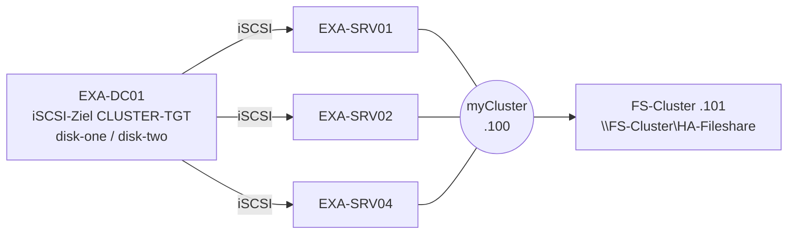

# Lab Failovercluster – hochverfügbarer Dateiserver

Thema: [[Cluster und Failover]] · Theorie: [[Failovercluster]] · [[Hochverfügbarer Dateiserver]] · Lab: [[VM-Infrastruktur]] · Fehler: [[Fehlerlog Home-Lab]]
Unterlagen: [[Uebung_Failovercluster.pdf|Übung (Original)]] · [[Uebung_Failovercluster_Loesung.pdf|Übung mit Lösung]] · [[Failovercluster_12_Fragen.pdf|Fragen A1–A12]] · [[Failovercluster_12_Fragen_Loesung.pdf|Lösungen]]

## 🎯 Ziel
Drei Server teilen sich zwei iSCSI-Datenträger von EXA-DC01. Daraus entsteht der Cluster **myCluster** mit der Dateiserver-Rolle **FS-Cluster** und der Freigabe **HA-Fileshare**, die einen Knotenausfall übersteht.

## 🖥️ Aufbau
| Maschine | Rolle | Adresse |
|---|---|---|
| EXA-DC01 | DC, DNS, [[iSCSI-Target\|iSCSI-Zielserver]], Failovercluster-Manager | IP des DC |
| EXA-SRV01 | Knoten · [[Bevorzugter Besitzer]] | Gateway 192.168.1.1 |
| EXA-SRV02 | Knoten | Gateway 192.168.1.1 |
| EXA-SRV04 | formatiert die Disks · ab Schritt 6 Knoten | Gateway 192.168.1.1 |
| myCluster | Cluster ([[CNO]]) | 192.168.1.100 |
| FS-Cluster | Dateiserver-Rolle ([[VCO]]) | 192.168.1.101 |



> [!warning] Nur Home-Lab: IP-Konflikt
> Laut [[VM-Infrastruktur|IP-Plan]] sind 192.168.1.100/.101 die Clients EXA-CL01/CL02; .100 ist außerdem für NLB *www.example.com* ([[Cluster und Failover]]) eingeplant. Zu Hause z. B. **.230** (myCluster) und **.231** (FS-Cluster) nehmen. In der Schule gelten die Adressen der Vorlage.

## 🧭 Ablauf
| Schritt | Inhalt | Maschine | Kernbefehl | Übung | Lösung | Theorie |
|---|---|---|---|---|---|---|
| 0 | Domänenbeitritt | EXA-SRV01/02/04 | `Add-Computer` | [[Uebung_Failovercluster.pdf#page=1\|S. 1]] | [[Uebung_Failovercluster_Loesung.pdf#page=1\|S. 1]] | – |
| 1 | iSCSI-Ziel, disk-one/-two | EXA-DC01 | `New-IscsiVirtualDisk` | [[Uebung_Failovercluster.pdf#page=1\|S. 1]] | [[Uebung_Failovercluster_Loesung.pdf#page=1\|S. 1]] | [[iSCSI]] |
| 2 | Initiatoren, Gateway, Volumes | EXA-SRV01/02/04 | `Connect-IscsiTarget` | [[Uebung_Failovercluster.pdf#page=1\|S. 1]] | [[Uebung_Failovercluster_Loesung.pdf#page=2\|S. 2]] | A12 |
| 3 | Feature Failover-Clustering | EXA-DC01 → Knoten | `Install-WindowsFeature` | [[Uebung_Failovercluster.pdf#page=1\|S. 1]] | [[Uebung_Failovercluster_Loesung.pdf#page=3\|S. 3]] | A3 |
| 4 | Validierung | EXA-DC01 | `Test-Cluster` | [[Uebung_Failovercluster.pdf#page=1\|S. 1]] | [[Uebung_Failovercluster_Loesung.pdf#page=3\|S. 3]] | A1 |
| 5 | Cluster mit 2 Knoten | EXA-DC01 | `New-Cluster` | [[Uebung_Failovercluster.pdf#page=1\|S. 1–2]] | [[Uebung_Failovercluster_Loesung.pdf#page=4\|S. 4]] | A4, A8 |
| 6 | Knoten EXA-SRV04 | EXA-DC01 | `Add-ClusterNode` | [[Uebung_Failovercluster.pdf#page=2\|S. 2]] | [[Uebung_Failovercluster_Loesung.pdf#page=4\|S. 4]] | A5, A9 |
| 7 | Quorum → Knotenmehrheit | EXA-DC01 | `Set-ClusterQuorum -NoWitness` | [[Uebung_Failovercluster.pdf#page=2\|S. 2]] | [[Uebung_Failovercluster_Loesung.pdf#page=5\|S. 5]] | A4, A5 |
| 8 | Dateiserver-Rolle FS-Cluster | EXA-DC01 | `Add-ClusterFileServerRole` | [[Uebung_Failovercluster.pdf#page=2\|S. 2]] | [[Uebung_Failovercluster_Loesung.pdf#page=5\|S. 5]] | A2, A8 |
| 9 | Freigabe HA-Fileshare | Besitzerknoten | `New-SmbShare -ScopeName` | [[Uebung_Failovercluster.pdf#page=3\|S. 3]] | [[Uebung_Failovercluster_Loesung.pdf#page=6\|S. 6]] | A6 |
| 10 | Besitzer, Failback, Verschieben | EXA-DC01 | `Set-ClusterOwnerNode` | [[Uebung_Failovercluster.pdf#page=3\|S. 3]] | [[Uebung_Failovercluster_Loesung.pdf#page=6\|S. 6]] | A1 |
| 11 | Ausfall EXA-SRV01 | EXA-DC01 | `Restart-Computer` | [[Uebung_Failovercluster.pdf#page=3\|S. 3]] | [[Uebung_Failovercluster_Loesung.pdf#page=7\|S. 7]] | A1, A6 |

Fehler der Vorlage (SYD-DC, PC1/PC2, Reiter „Failback“): [[Uebung_Failovercluster_Loesung.pdf#page=8|Anhang A]]

## ✅ Validierung (PowerShell)
```powershell
# Maschine: EXA-DC01
Get-IscsiServerTarget -TargetName CLUSTER-TGT | Format-List Status, LunMappings   # Connected, 2 Disks
Get-ClusterNode   -Cluster myCluster | Format-Table Name, State                    # 3 x Up
Get-ClusterQuorum -Cluster myCluster                                               # NodeMajority
Get-ClusterGroup  -Cluster myCluster | Format-Table Name, OwnerNode, State          # FS-Cluster Online
Get-ClusterOwnerNode -Cluster myCluster -Group FS-Cluster                          # SRV01, SRV02, SRV04
Get-ADComputer -Filter "Name -eq 'myCluster' -or Name -eq 'FS-Cluster'"           # CNO + VCO
Resolve-DnsName FS-Cluster.example.com                                             # 192.168.1.101
Test-Path \\FS-Cluster\HA-Fileshare                                                # True
```

## 🧯 Typische Fehler
| Symptom | Ursache | Lösung |
|---|---|---|
| Validierung: Speicher rot | Knoten ohne iSCSI-Verbindung oder Disk noch online auf EXA-SRV04 | `Get-IscsiSession` je Knoten; Disk auf EXA-SRV04 offline |
| Initiator findet kein Ziel | Zugriffsserver am Ziel falsch (DNS-Name/IQN) | `Get-IscsiServerTarget` → InitiatorIds prüfen |
| `New-Cluster`: Name existiert / Zugriff verweigert | altes Computerkonto myCluster im AD | Konto löschen oder vorab anlegen (Prestaging) |
| Rolle FS-Cluster startet nicht | CNO darf in der OU keine Computerobjekte erstellen | Recht „Computerobjekte erstellen“ für myCluster$ |
| Kein Failback nach Neustart | AutoFailbackType 0 oder Zeitfenster gesetzt | `AutoFailbackType 1`, Fenster `-1/-1` |
| IP-Konflikt .100/.101 (Home-Lab) | Clients CL01/CL02 oder NLB nutzen die Adressen | .230/.231 verwenden |

## 📝 Ergebnis / Notizen
- [ ] Schritte 0–11 erledigt
- [ ] Fragen A1–A12 beantwortet und mit [[Failovercluster_12_Fragen_Loesung.pdf|Lösung]] verglichen
- Beobachtung Schritt 11:
