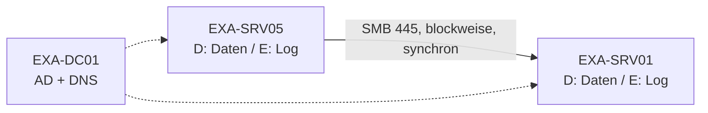

# Lab Storage Replica – Test, Partnerschaft, Failover

Thema: [[Windows Server]] · Theorie: [[Storage Replica]] · [[Speicherpools]] · Lab: [[VM-Infrastruktur]] · Fehler: [[Fehlerlog Home-Lab]] · Glossar: [[SR]] · [[SMB]]

## 🎯 Ziel
Speicherwiederherstellung: Volume D: von EXA-SRV05 blockweise auf EXA-SRV01 replizieren, Ausfall simulieren (Failover), zurückschalten, aufräumen.

## 🖥️ Aufbau
| Maschine | Rolle | Datenträger |
|---|---|---|
| EXA-DC01 | Domänencontroller (example.com) | – |
| EXA-SRV05 | **Quelle** (Source) | D: Daten · E: Log |
| EXA-SRV01 | **Ziel** (Destination) | D: Daten · E: Log |

> [!question] Klären
> Im Aufbau stand **SRV04**, in allen Befehlen **exa-srv05**. Falls es SRV04 war: Tabelle und Befehle anpassen.



## ✅ Checkliste
- [ ] 0 Vorbereitung: Feature, Datenträger, Firewall
- [ ] 1 `Test-SRTopology` – Bericht ansehen
- [ ] 2 `New-SRPartnership`
- [ ] 3 Erstsynchronisierung abwarten
- [ ] 4 Testdaten auf Quelle anlegen
- [ ] 5 Failover mit `Set-SRPartnership` → Testdaten auf Ziel prüfen
- [ ] 6 Zurückschalten
- [ ] 7 Aufräumen

---

## 0 Vorbereitung
**Feature – Maschine: EXA-SRV05 und EXA-SRV01** (PowerShell als Admin)
```powershell
Install-WindowsFeature Storage-Replica, FS-FileServer -IncludeManagementTools -Restart
Get-WindowsFeature Storage-Replica          # Install State = Installed
```

**Datenträger D: und E: anlegen – Maschine: EXA-SRV05 und EXA-SRV01** (neue, leere Platten in Hyper-V hinzugefügt)
```powershell
Get-Disk                                     # Nummern der neuen Platten (PartitionStyle RAW)
Initialize-Disk -Number 1 -PartitionStyle GPT
Initialize-Disk -Number 2 -PartitionStyle GPT
New-Partition -DiskNumber 1 -DriveLetter D -UseMaximumSize | Format-Volume -FileSystem NTFS -NewFileSystemLabel Daten
New-Partition -DiskNumber 2 -DriveLetter E -UseMaximumSize | Format-Volume -FileSystem NTFS -NewFileSystemLabel Log
Get-Volume -DriveLetter D,E | Format-Table DriveLetter, FileSystemLabel, Size
```
> [!warning] Pflicht
> - D: auf beiden Servern **gleich groß**, E: ebenfalls
> - GPT, nicht die Systemplatte
> - Log-Volume ≥ 9 GB empfohlen (Standard-Loggröße 8 GB). Kleiner im Lab: bei `New-SRPartnership` `-LogSizeInBytes 1GB` angeben
> - **Daten auf Ziel-D: werden überschrieben!**

**Erreichbarkeit – Maschine: EXA-SRV05**
```powershell
Test-NetConnection exa-srv01 -Port 445     # SMB
Test-NetConnection exa-srv01 -Port 5985    # WS-MAN / WinRM
```

## 1 Test
**Maschine: EXA-SRV05**
```powershell
New-Item C:\temp -ItemType Directory -Force
Test-SRTopology -SourceComputerName exa-srv05 -SourceVolumeName D: -SourceLogVolumeName E: `
  -DestinationComputerName exa-srv01 -DestinationVolumeName D: -DestinationLogVolumeName E: `
  -ResultPath C:\temp -DurationInMinutes 2
Invoke-Item (Get-ChildItem C:\temp\TestSrTopologyReport*.html | Select-Object -Last 1).FullName
```
> [!tip] Während der 2 Minuten Last erzeugen (z. B. Dateien nach D: kopieren), sonst sagt der Durchsatztest wenig aus.

## 2 Partnerschaft anlegen
**Maschine: EXA-SRV05**
```powershell
New-SRPartnership -SourceComputerName exa-srv05 -SourceRGName mySRrep -SourceVolumeName D: -SourceLogVolumeName E: `
  -DestinationComputerName exa-srv01 -DestinationRGName mySRrep -DestinationVolumeName D: -DestinationLogVolumeName E:
```
Varianten:
```powershell
# kleineres Log im Lab
New-SRPartnership ... -LogSizeInBytes 1GB
# asynchron (z. B. entfernter Standort)
New-SRPartnership ... -ReplicationMode Asynchronous
```
> [!note] Gruppennamen
> Beide Gruppen heißen `mySRrep` – erlaubt, weil jede Gruppe auf ihrem eigenen Server liegt. Übersichtlicher: `rg-srv05` / `rg-srv01`.

## 3 Erstsynchronisierung überwachen
**Maschine: EXA-SRV01** (Ziel)
```powershell
Get-SRPartnership
(Get-SRGroup).Replicas | Select-Object DataVolume, ReplicationStatus, NumOfBytesRemaining

# Fortschritt alle 5 s, bis fertig
while (((Get-SRGroup).Replicas).NumOfBytesRemaining -gt 0) {
  "{0:N0} MB übrig" -f (((Get-SRGroup).Replicas).NumOfBytesRemaining / 1MB); Start-Sleep 5 }
"Fertig: " + ((Get-SRGroup).Replicas).ReplicationStatus

Get-WinEvent -ProviderName Microsoft-Windows-StorageReplica -MaxEvents 20 |
  Format-Table TimeCreated, Id, Message -Wrap
```
Erwartet: `ReplicationStatus` = **ContinuouslyReplicating**, Bytes = 0.
Auf EXA-SRV01 ist D: jetzt **gesperrt** (nicht zugreifbar) – das ist richtig so.

## 4 Testdaten auf der Quelle
**Maschine: EXA-SRV05**
```powershell
"Replikationstest $(Get-Date)" | Out-File D:\SR-Test.txt
fsutil file createnew D:\SR-Gross.dat 524288000     # 500 MB Testdatei
Get-ChildItem D:\
```

## 5 Failover (Ziel wird Quelle) ✅ ausgeführt
**Maschine: EXA-SRV01**
```powershell
Set-SRPartnership -NewSourceComputerName exa-srv01 -SourceRGName mySRrep `
  -DestinationComputerName exa-srv05 -DestinationRGName mySRrep
```
**Prüfen – Maschine: EXA-SRV01**
```powershell
Get-SRPartnership                     # SourceComputerName = exa-srv01
Get-Content D:\SR-Test.txt            # Testdaten da?
Get-ChildItem D:\
```
Jetzt ist D: auf **EXA-SRV05 gesperrt** und auf EXA-SRV01 nutzbar.

> [!warning] Echter Ausfall
> Ist die Quelle **wirklich weg** (aus, defekt), auf dem Ziel zusätzlich `-Force` anhängen:
> `Set-SRPartnership -NewSourceComputerName exa-srv01 -SourceRGName mySRrep -DestinationComputerName exa-srv05 -DestinationRGName mySRrep -Force`

## 6 Zurückschalten
**Maschine: EXA-SRV05**
```powershell
Set-SRPartnership -NewSourceComputerName exa-srv05 -SourceRGName mySRrep `
  -DestinationComputerName exa-srv01 -DestinationRGName mySRrep
Get-SRPartnership
Get-ChildItem D:\                     # Änderungen von EXA-SRV01 jetzt auch hier
```
Tipp: Vorher auf EXA-SRV01 eine Datei ändern → nach dem Zurückschalten auf EXA-SRV05 prüfen.

## 7 Aufräumen
**Maschine: aktuelle Quelle (EXA-SRV05)**
```powershell
Get-SRPartnership | Remove-SRPartnership
```
**Maschine: EXA-SRV05 und EXA-SRV01**
```powershell
Get-SRGroup | Remove-SRGroup
Get-Volume -DriveLetter D             # D: auf beiden wieder normal nutzbar
```

---

## 📊 Ergebnis
| Prüfung | Ergebnis | Bemerkung |
|---|---|---|
| Voraussetzungen (Edition, Domäne, Volumes) | ☐ ok ☐ Fehler | |
| Netzwerk/Firewall (445, 5985) | ☐ ok ☐ Fehler | |
| Durchsatz synchron ausreichend | ☐ ja ☐ nein | |
| Partnerschaft angelegt | ☐ ok ☐ Fehler | |
| Erstsynchronisierung fertig (Bytes = 0) | ☐ ja ☐ nein | Dauer: |
| Failover: Testdaten auf EXA-SRV01 | ☐ ja ☐ nein | |
| Zurückschalten: Änderungen auf EXA-SRV05 | ☐ ja ☐ nein | |
| Aufgeräumt | ☐ ja ☐ nein | |

## ⚠️ Typische Fehler
| Meldung / Symptom | Ursache | Lösung |
|---|---|---|
| Volumes unterschiedlich groß | D: oder E: nicht identisch | Partition anpassen (`Resize-Partition`) |
| Log-Volume zu klein | E: < Loggröße (8 GB) | E: vergrößern oder `-LogSizeInBytes 1GB` |
| Zugriff verweigert / WinRM-Fehler | Firewall, kein Domänenadmin | `Test-NetConnection …-Port 5985`, mit Domänenadmin anmelden |
| Edition nicht unterstützt | Standard-Edition (nur 1 Volume, max. 2 TB) | Datacenter oder Grenzen beachten |
| Ziel-D: nicht im Explorer | normal während Replikation | erst nach Failover/Entfernen sichtbar |
| Partnerschaft existiert bereits | Befehl doppelt ausgeführt | `Get-SRPartnership` prüfen, ggf. aufräumen |

## 📝 Beobachtungen
- 

## ❓ Prüffragen
1. Warum ist D: auf dem Ziel während der Replikation gesperrt?
2. Wozu dient das Log-Volume E:?
3. Was ist der Unterschied zwischen `Set-SRPartnership` mit und ohne `-Force`?
4. Wann würdest du `-ReplicationMode Asynchronous` wählen?

## 📄 Unterlagen
- Theorie: [[Storage Replica]]
- Buch 70-740: [[70-740_Server2016_Installation_Speicher.pdf#page=182|Szenarien]] · [[70-740_Server2016_Installation_Speicher.pdf#page=185|Voraussetzungen]] · [[70-740_Server2016_Installation_Speicher.pdf#page=186|Test-SRTopology]] · [[70-740_Server2016_Installation_Speicher.pdf#page=188|New-SRPartnership, Ereignisse]]
- [Microsoft Learn – Server-zu-Server](https://learn.microsoft.com/de-de/windows-server/storage/storage-replica/server-to-server-storage-replication)
