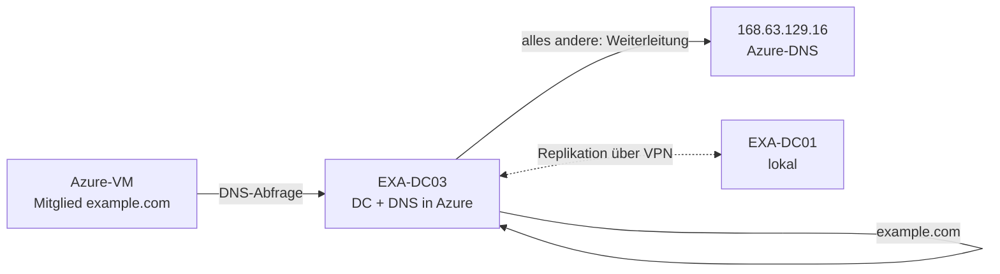

# DNS und DHCP in Azure und hybrid – Übersicht

Kapitel: [[AZ-802 Übersicht]] · Prüfungsbereich: [[AZ-802 4 Netzwerk DNS DHCP]] · Grundlagen: [[Azure-Grundlagen für Windows-Admins]] · [[Cloud-Modelle IaaS PaaS SaaS]]
Lokal (Schule): [[Forward-Lookup-Zone]] · [[Reverse-Lookup-Zone]] · [[DNS-Records]] · [[DHCP-Server]]

> [!summary] Kernidee
> - **DHCP in Azure macht Azure selbst** – du stellst IPs an der **Netzwerkkarte in Azure** ein, nie im Gast-Windows.
> - **DNS in Azure** gibt es dreifach: Azure-eigene Auflösung (168.63.129.16), **Azure DNS** (öffentliche/private Zonen) und **eigene DNS-Server** (DCs auf Azure-VMs).
> - Für **AD DS** brauchst du weiterhin Windows-DNS (DCs). Azure DNS ergänzt, ersetzt es aber nicht.

## Lernpfad auf Microsoft Learn (6 Module)
| # | Modul | Lokal / Azure | Im Vault |
|---|---|---|---|
| 1 | [Implementieren von Windows Server-DNS](https://learn.microsoft.com/de-de/training/modules/implement-windows-server-dns/) | lokal | [[Forward-Lookup-Zone]] · [[Bedingte Weiterleitung]] · Abschnitt 6 |
| 2 | [Implementieren von DNS für Windows Server-IaaS-VMs](https://learn.microsoft.com/de-de/training/modules/implement-dns-for-windows-server-iaas-virtual-machines/) | **Azure** | Abschnitte 1–3, 7 |
| 3 | [Absichern von Windows Server-DNS](https://learn.microsoft.com/de-de/training/modules/secure-windows-server-domain-name-system/) | lokal | [[DNS-Richtlinien]] · [[DNSSEC]] · Abschnitt 6 |
| 4 | [Bereitstellen und Verwalten des DHCP](https://learn.microsoft.com/de-de/training/modules/deploy-manage-dynamic-host-configuration-protocol/) | lokal | [[DHCP-Server]] · [[DHCP-Failover]] · Abschnitt 5 |
| 5 | [Implementieren der IP-Adressverwaltung](https://learn.microsoft.com/de-de/training/modules/implement-ip-address-management/) | lokal | [[IPAM]] · Abschnitt 8 |
| 6 | [IP-Adressierung und Routing für Windows Server-IaaS-VMs](https://learn.microsoft.com/de-de/training/modules/implement-windows-server-iaas-virtual-machine-ip-addressing-routing/) | **Azure** | Abschnitte 4–5 |

## 1. DNS-Optionen in Azure im Vergleich
| Option | Was | Kann | Kann nicht |
|---|---|---|---|
| **Azure-bereitgestellte Auflösung** (Standard) | Azure-DNS unter **168.63.129.16**, automatisch für jede VM | Hostnamen der VMs **im selben VNet**, Internetnamen | VNet-übergreifend, eigene Zonen, AD-Namen, von lokal erreichbar |
| **[[Private DNS-Zone]]** (Azure DNS privat) | eigene Zone (z. B. `az.example.com`), mit VNets **verknüpft** | Auto-Registrierung der VMs (A-Einträge), VNet-übergreifend ohne Peering, Reverse (PTR) für private IPs, Split-Horizon | Zonenübertragung, DNSSEC, Dynamic Update durch Windows-Clients |
| **Öffentliche Zone** ([[Azure DNS]]) | autoritatives DNS für Internetdomänen, weltweit per Anycast | Delegierung von der Registrierungsstelle, RBAC, Alias-Einträge, DNSSEC-Signierung | rekursive Auflösung, Zonenübertragung |
| **Eigene DNS-Server** (IaaS, meist DCs) | Windows-DNS auf Azure-VMs, im VNet als DNS-Server eingetragen | **AD DS**, bedingte Weiterleitung, Zonenübertragung, DNSSEC, DNS-Richtlinien | – (du verwaltest alles selbst) |
| **[[Azure DNS Private Resolver]]** | verwaltete Weiterleitung zwischen lokal und Azure | lokal → private Azure-Zonen (eingehend), Azure → lokale Zonen (ausgehend + Regelsatz) | eigene Zonen hosten |

> [!warning] Kurs teilweise veraltet (geprüft 21.10.2026)
> Das Lernmodul nennt für private Zonen „nur ein VNet je Zone“, „keine bedingte Weiterleitung“ und für Azure DNS „kein DNSSEC“. **Heute:** eine private Zone kann mit vielen VNets verknüpft werden (bis 1000, davon bis 100 mit Auto-Registrierung); bedingte Weiterleitung leistet der **Private Resolver** (Weiterleitungsregelsatz); **öffentliche** Azure-DNS-Zonen unterstützen DNSSEC (GA). Private Zonen weiterhin ohne DNSSEC und ohne Zonenübertragung. Für die Prüfung: aktuelle Doku zählt.

### Private DNS-Zone – Regeln
- **VNet-Verknüpfung** nötig, sonst sieht das VNet die Zone nicht.
- **Auto-Registrierung** pro Verknüpfung: VMs bekommen automatisch einen A-Eintrag; Änderungen/Löschen werden nachgezogen.
- Ein VNet kann nur mit **einer** privaten Zone **mit Auto-Registrierung** verknüpft sein (Auflösung aus vielen Zonen ist möglich).
- Typisch für **Private Endpoints**: `privatelink.file.core.windows.net` für [[Azure Files]].

## 2. AD DS in Azure: DNS richtig einstellen

1. DC-VM mit **statischer privater IP in der Azure-NIC**.
2. **VNet → DNS-Server: Benutzerdefiniert** = IP(s) der DCs (mehrere möglich). VMs übernehmen das nach Neustart bzw. DHCP-Erneuerung.
3. Auf dem DC: **Weiterleitung an 168.63.129.16** → Azure-Namen und Internet; eigene Domäne beantwortet der DC.
4. Mehrere VNets: jedes hat eigenes Suffix → **bedingte Weiterleitungen** je Suffix oder gemeinsame private Zone.
5. Lokale Clients sollen Azure-VMs finden → bedingte Weiterleitung auf lokalen DNS zum DC in Azure oder zum Private Resolver.

```powershell
# Maschine: EXA-DC03 (DC als Azure-VM) – Azure als Weiterleitung
Set-DnsServerForwarder -IPAddress 168.63.129.16
# Maschine: Admin-PC (Az-Modul) – VNet auf eigene DNS-Server umstellen
$vnet = Get-AzVirtualNetwork -Name vnet-az802 -ResourceGroupName rg-az802-lab
$vnet.DhcpOptions.DnsServers = @('10.10.1.4','10.10.1.5')
$vnet | Set-AzVirtualNetwork
```

## 3. Split-Horizon-DNS
Gleicher Domänenname, **intern andere Antwort als extern**.
| Umgebung | Umsetzung |
|---|---|
| **Azure** | **zwei Zonen gleichen Namens**: öffentliche Zone (öffentliche IPs, MX) + private Zone (mit VNet verknüpft, private IPs/CNAMEs) |
| **Windows Server** | **eine** Zone + [[DNS-Richtlinien]] (Zonenbereiche je Client-Subnetz) |

Beispiel Azure: `relay.contoso.com` → extern 131.107.1.201 (öffentliche Zone), intern CNAME → `exchange1.contoso.com` → 192.168.1.201 (private Zone).
```powershell
# Maschine: Admin-PC (Az-Modul)
New-AzDnsZone -Name contoso.com -ResourceGroupName rg-az802-lab                         # öffentlich
New-AzDnsRecordSet -ZoneName contoso.com -ResourceGroupName rg-az802-lab -Name relay -RecordType A -Ttl 3600 `
  -DnsRecords (New-AzDnsRecordConfig -IPv4Address 131.107.1.201)
New-AzPrivateDnsZone -Name contoso.com -ResourceGroupName rg-az802-lab                  # privat
New-AzPrivateDnsVirtualNetworkLink -ZoneName contoso.com -ResourceGroupName rg-az802-lab -Name link-vnet `
  -VirtualNetworkId $vnet.Id -EnableRegistration
Get-AzDnsZone -Name contoso.com -ResourceGroupName rg-az802-lab | Select-Object -ExpandProperty NameServers   # für Delegierung beim Registrar
```

## 4. IP-Adressen in Azure (Azure übernimmt DHCP)
| Thema | Regel |
|---|---|
| Vergabe | Azure-DHCP aus dem Subnetzbereich, **Lease unbegrenzt** |
| Reservierte Adressen | **erste 4** und **letzte** Adresse jedes Subnetzes (z. B. .0 Netz, .1 Gateway, .2/.3 Azure-DNS, .255 Broadcast) |
| Dynamisch (Standard) | nächste freie IP; geht bei **Beenden (Zuordnung aufheben)** ggf. verloren |
| Statisch | an der **NIC in Azure** festlegen → bleibt bis NIC gelöscht; für DCs, DNS, Firewall-Regeln |
| Im Gast | **IP nie im Windows ändern** → VM unerreichbar; Gast bleibt auf DHCP |
| Öffentliche IP | SKU **Standard** (nur statisch, zonenredundant möglich); Basic ist abgekündigt |
| Mehrere IPs | sekundäre IP-Konfigurationen je NIC, mehrere NICs je VM (je nach Größe) |
| IPv6 | Dual-Stack-VNets (IPv4 + IPv6) möglich |

> [!info] Eigener DHCP-Server in Azure?
> Für **Azure-VMs nicht möglich** – Azure beantwortet DHCP selbst. Ein DHCP-Server auf einer Azure-VM kann nur **lokale Clients über DHCP-Relay** (VPN/ExpressRoute) bedienen, mit Sonderkonfiguration. Lokal bleibt DHCP klassisch → Abschnitt 5.

```powershell
# Maschine: Admin-PC (Az-Modul) – private IP statisch setzen
$nic = Get-AzNetworkInterface -Name nic-exa-dc03 -ResourceGroupName rg-az802-lab
$nic.IpConfigurations[0].PrivateIpAllocationMethod = 'Static'
$nic.IpConfigurations[0].PrivateIpAddress = '10.10.1.4'
$nic | Set-AzNetworkInterface       # löst Neustart des Gast-Betriebssystems aus
```

### Routing in Azure
| Begriff | Bedeutung |
|---|---|
| Systemrouten | automatisch je Subnetz: VNet intern, 0.0.0.0/0 → Internet, private Bereiche außerhalb des VNets → verwerfen (None) |
| [[UDR]] (benutzerdefinierte Route) | Routentabelle → Subnetz zuordnen; Nächster Hop z. B. **virtuelles Gerät** (Firewall-VM), VNet-Gateway, Internet, None |
| BGP | Routen vom lokalen Netz über das VPN-Gateway gelernt |
| Vorrang bei gleichem Präfix | **UDR > BGP > System** (sonst gilt das längste Präfix) |
| IP-Weiterleitung | an der NIC einer Firewall-/Router-VM einschalten |
| Forced Tunneling | UDR 0.0.0.0/0 → lokales Netz/Firewall: aller Internetverkehr über die Firma |
| Prüfen | Network Watcher → **Nächster Hop**, **Effektive Routen** der NIC |

## 5. DHCP lokal (Windows Server) – Kurzfassung
| Thema | Kernpunkt |
|---|---|
| Lease-Ablauf | **DORA**: Discover → Offer → Request → Acknowledge (Broadcast UDP 67/68); Verlängerung bei 50 % und 87,5 % der Lease-Dauer |
| Autorisierung | im AD, sonst startet der Dienst die Vergabe nicht |
| Optionen | Ebenen **Server → Bereich → Reservierung** (spezifischer gewinnt); 003 Router, 006 DNS, 015 Domäne |
| Bereich | Adressbereich, Ausschlüsse, Reservierungen, Lease-Dauer |
| Andere Subnetze | DHCP-Relay-Agent / IP-Helper am Router |
| Ausfallsicherheit | [[DHCP-Failover]]: Lastenausgleich oder Hot Standby |
→ Befehle: [[AZ-802 4 Netzwerk DNS DHCP#6. DHCP|Bereich 4, DHCP]] · [[DHCP-Server]]

## 6. DNS lokal – was Azure nicht ersetzt
| Funktion | Windows-DNS | Azure DNS |
|---|---|---|
| AD-integrierte Zonen, sichere dynamische Updates | ✅ | ❌ |
| Bedingte Weiterleitung, Stubzonen | ✅ | nur über Private Resolver |
| Zonenübertragung | ✅ | ❌ |
| DNS-Richtlinien (Split-Brain, Geo, Uhrzeit) | ✅ | ❌ (Split-Horizon über zwei Zonen) |
| DNSSEC | ✅ | nur öffentliche Zonen |
| Sicherheit: Cachesperrung, Socketpool, Antwortratenbegrenzung (RRL) | ✅ | verwaltet |
| Verwaltung | DNS-Manager, PowerShell | Portal, Az PowerShell, CLI, RBAC |

```powershell
# Maschine: EXA-DC01 – DNS-Absicherung (Modul 3)
Set-DnsServerCache -LockingPercent 100                      # Cachesperrung
dnscmd /Config /SocketPoolSize 10000                         # Socketpool (Neustart DNS-Dienst)
Set-DnsServerResponseRateLimiting -Mode Enable               # Antwortratenbegrenzung
Get-DnsServerResponseRateLimiting
```

## 7. Problembehandlung
| Problem | Prüfen |
|---|---|
| Azure: Zone lässt sich nicht anlegen | Name in der Ressourcengruppe schon vergeben? Zonenlimit im Abonnement? Aktivitätsprotokoll |
| Azure: Eintrag lässt sich nicht anlegen | Recordset existiert schon? Zonenstamm = `@`; CNAME-Konflikt; Recordset-Limit |
| Azure: Name wird nicht aufgelöst | Schreibweise; Eintrag in der Zone; direkt bei den Azure-Nameservern abfragen; VNet-Verknüpfung (privat); Delegierung beim Registrar (öffentlich); Client-Cache leeren |
| VM findet AD nicht | VNet-DNS-Server = DCs? VM neu gestartet / `ipconfig /renew`? |
| Lokal findet Azure-Namen nicht | bedingte Weiterleitung, Private Resolver, VPN/Routing |

```powershell
# Maschine: Azure-VM oder lokaler Client
Clear-DnsClientCache
Resolve-DnsName exa-srv01.example.com
Resolve-DnsName www.contoso.com -Server ns1-01.azure-dns.com       # direkt beim Azure-Namenserver
nslookup -d2 exa-dc01.example.com. > C:\Temp\nslookup.txt
Test-DnsServer -IPAddress 10.10.1.4 -ZoneName example.com
Get-DnsClientServerAddress -AddressFamily IPv4
```

## 8. IPAM (IP-Adressverwaltung)
- Windows-Server-Feature: **zentrale Verwaltung** von DHCP-Servern, DNS-Zonen und IP-Adressräumen (lokal).
- Auf einem **Mitgliedsserver** (nicht DC), Datenbank **WID** oder **SQL Server**.
- Bereitstellung der verwalteten Server per **GPO** (`Invoke-IpamGpoProvisioning`), Serverermittlung im AD.
- Verwaltet: DNS-Zonen/Einträge, DHCP-Bereiche/Failover, IP-Blöcke/Bereiche, Auslastung, Überwachung (wer hatte wann welche IP).
- Rechte über eigene **RBAC-Rollen** und **Zugriffsbereiche**.
- Azure-Gegenstück: Azure Virtual Network Manager mit **IPAM-Pools** (Adressräume planen).
```powershell
# Maschine: EXA-SRV01 (Mitgliedsserver)
Install-WindowsFeature IPAM -IncludeManagementTools
Invoke-IpamGpoProvisioning -Domain example.com -GpoPrefixName IPAM -IpamServerFqdn exa-srv01.example.com
```

## 9. Prüfungsfragen
1. Eine Azure-VM ist DC. Wo stellst du die statische IP ein?
2. Warum lösen Azure-VMs in VNet B die Namen aus VNet A mit der Azure-Standardauflösung nicht auf – und was hilft?
3. Wie erreicht ein DNS-Server auf einer Azure-VM die Azure-Namensauflösung?
4. Split-Horizon in Azure vs. Windows Server – Unterschied?
5. Kann man einen Windows-DHCP-Server für Azure-VMs betreiben?
6. Wer gewinnt: UDR oder BGP-Route mit gleichem Präfix?

> [!success]- Lösungen
> 1. An der **NIC in Azure** (Portal/PowerShell), nicht im Gast.
> 2. Standardauflösung gilt nur im **eigenen VNet** → private DNS-Zone mit beiden VNets verknüpfen oder eigene DNS-Server mit bedingten Weiterleitungen.
> 3. Weiterleitung an **168.63.129.16**.
> 4. Azure: zwei Zonen gleichen Namens (öffentlich + privat). Windows: eine Zone + DNS-Richtlinien/Zonenbereiche.
> 5. Nein – Azure vergibt die IPs selbst; nur lokale Clients über Relay wären möglich.
> 6. **UDR** (UDR > BGP > System).

## Quellen
- [Lernpfad: Implementieren und Verwalten einer lokalen und Hybridnetzwerkinfrastruktur – Microsoft Learn](https://learn.microsoft.com/de-de/training/paths/implement-manage-premises-hybrid-networking-infrastructure/)
- [Modul: DNS für Windows Server-IaaS-VMs – Microsoft Learn](https://learn.microsoft.com/de-de/training/modules/implement-dns-for-windows-server-iaas-virtual-machines/)
- [Modul: IP-Adressierung und Routing für IaaS-VMs – Microsoft Learn](https://learn.microsoft.com/de-de/training/modules/implement-windows-server-iaas-virtual-machine-ip-addressing-routing/)
- [Modul: IP-Adressverwaltung – Microsoft Learn](https://learn.microsoft.com/de-de/training/modules/implement-ip-address-management/)
- [What is an Azure Private DNS zone? – Microsoft Learn](https://learn.microsoft.com/azure/dns/private-dns-privatednszone)
- [Azure Public DNS overview – Microsoft Learn](https://learn.microsoft.com/azure/dns/public-dns-overview)
- [GA: Azure DNS Public Zones DNSSEC (Message Center AZ479465)](https://mc.merill.net/message/AZ479465)
