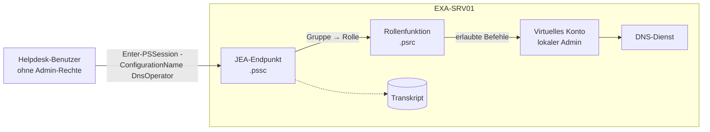

# JEA – Just Enough Administration (Übersicht)

Kapitel: [[AZ-802 Übersicht]] · Prüfungsbereich: [[AZ-802 2 Hybride Verwaltung]] · Glossar: [[JEA]] · Vorwissen: [[PowerShell Grundlagen]] · [[PS-Remoting]] · [[WinRM]]

> [!summary] Kernidee
> - **Problem:** Helpdesk soll z. B. nur den DNS-Cache leeren – dafür braucht er heute Admin-Rechte auf dem Server.
> - **JEA:** ein eigener PowerShell-Remoting-**Endpunkt**, der **nur erlaubte Befehle** zeigt und sie unter einem **temporären Admin-Konto** ausführt.
> - Der Benutzer selbst bleibt **ohne Admin-Rechte** – und alles wird **protokolliert**.

## Unterpunkte
| # | Notiz | Inhalt |
|---|---|---|
| 1 | [[JEA Grundlagen und Ablauf]] | Prinzip, Bausteine, Ablauf einer Sitzung, Voraussetzungen |
| 2 | [[JEA Rollenfunktionsdatei]] | `.psrc`: welche Befehle, Parameter, Werte erlaubt sind |
| 3 | [[JEA Sitzungskonfiguration]] | `.pssc`: Sitzungstyp, RunAs, Gruppe → Rolle, Transkript |
| 4 | [[JEA RunAs-Konten]] | virtuelles Konto vs. gMSA, Falle auf DCs |
| 5 | [[JEA Bereitstellen und Verbinden]] | registrieren, testen, verbinden, mehrere Server |
| 6 | [[JEA Sicherheit und Überwachung]] | gefährliche Befehle, Protokolle, Prüfung |
| 7 | [[JEA Lab DNS-Operator]] | Schritt für Schritt im Home-Lab |

## Bild im Kopf

## Die 3 Bausteine
| Baustein | Datei | Frage, die er beantwortet |
|---|---|---|
| **Rollenfunktion** (Role Capability) | `Name.psrc` im Ordner `RoleCapabilities` eines Moduls | **Was** darf man tun? |
| **Sitzungskonfiguration** (Session Configuration) | `Name.pssc` → registriert als Endpunkt | **Wer** bekommt **welche Rolle**, unter **welchem Konto**? |
| **Endpunkt** | `Register-PSSessionConfiguration` | **Wie** verbindet man sich? (`-ConfigurationName`) |

## Merksätze für die Prüfung
- Nur **PowerShell-Remoting über WinRM** – kein RDP, kein SSH.
- `SessionType RestrictedRemoteServer` + **NoLanguage**-Modus → keine Variablen, keine Skriptblöcke, nur erlaubte Befehle.
- Rollenfunktionsdateien werden nur gefunden, wenn sie in **`<Modul>\RoleCapabilities\`** unter einem Pfad aus `$env:PSModulePath` liegen.
- **Virtuelles Konto** = lokaler Admin auf Mitgliedsservern, auf **DCs = Domänen-Admin** → einschränken.
- Netzwerkzugriff aus der JEA-Sitzung (Doppel-Hop) → **gMSA** statt virtuellem Konto.
- Prüfen, was ein Benutzer darf: `Get-PSSessionCapability -ConfigurationName … -Username …`.
- [[Windows Admin Center]] nutzt JEA für seine rollenbasierte Zugriffssteuerung.

## Quellen
- [JEA overview – Microsoft Learn](https://learn.microsoft.com/en-us/powershell/scripting/security/remoting/jea/overview)
- [JEA Role Capabilities – Microsoft Learn](https://learn.microsoft.com/en-us/powershell/scripting/security/remoting/jea/role-capabilities)
- [JEA Session Configurations – Microsoft Learn](https://learn.microsoft.com/en-us/powershell/scripting/security/remoting/jea/session-configurations)
- [JEA Security considerations – Microsoft Learn](https://learn.microsoft.com/en-us/powershell/scripting/security/remoting/jea/security-considerations)
- [Study guide AZ-802 – Microsoft Learn](https://learn.microsoft.com/en-us/credentials/certifications/resources/study-guides/az-802)
