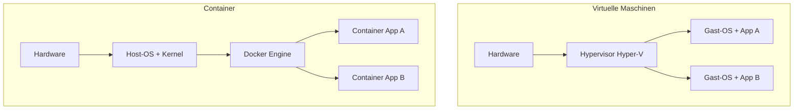
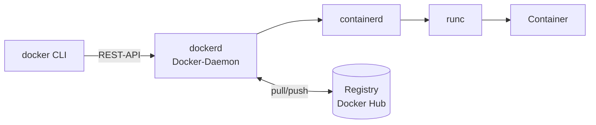
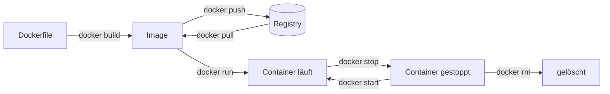

# 01 Docker – Grundlagen
← [[00_Docker-Uebersicht]] · → [[02_Docker-Installation]]

**Inhalt:** [[#1 Was ist Docker]] · [[#2 Container vs. VM]] · [[#3 Architektur]] · [[#4 Lebenszyklus]] · [[#5 Wofür im Job]] · [[#6 Kontrollfragen]]

---

## 1 Was ist Docker
- [[Docker]] verpackt eine Anwendung **mit allen Abhängigkeiten** in ein [[Image]].
- Ein laufendes Image ist ein [[Container]]: isolierter Prozess auf dem Host.
- Ziel: „Läuft bei mir“ = läuft überall (Dev, Test, Produktion).

---

## 2 Container vs. VM

| Merkmal | Virtuelle Maschine (Hyper-V) | Container (Docker) |
|---|---|---|
| Virtualisiert | Hardware | Betriebssystem |
| Eigener Kernel | ja | **nein**, nutzt Host-Kernel |
| Größe | GB | MB |
| Startzeit | Minuten | Sekunden |
| Isolation | stark | geringer ([[Namespace]], [[cgroups]]) |
| Typischer Einsatz | ganze Server (DC, CA) | einzelne Dienste (Web, DB, Tools) |

> [!important] Folge des geteilten Kernels
> Linux-Container brauchen einen **Linux-Kernel**, Windows-Container einen **Windows-Kernel**. Docker Desktop auf Windows startet dafür eine Linux-VM über [[WSL2]].

---

## 3 Architektur

| Komponente | Aufgabe |
|---|---|
| `docker` ([[CLI]]) | nimmt Befehle an, schickt sie an den Daemon |
| [[Docker-Daemon]] (`dockerd`) | verwaltet Images, Container, Netze, Volumes |
| [[Containerd]] / `runc` | startet die Container ([[OCI]]-Standard) |
| [[Registry]] | Ablage für Images, z. B. [[Docker-Hub]] |

Zusammen: [[Docker-Engine]].

---

## 4 Lebenszyklus

- **Image** = Bauplan, schreibgeschützt, besteht aus [[Image-Layer|Layern]].
- **Container** = Image + beschreibbare Schicht. Löschen = Daten weg → [[Volume]] nutzen.

---

## 5 Wofür im Job

| Einsatz | Beispiel |
|---|---|
| Tools schnell bereitstellen | Monitoring, Wiki, Passwortmanager |
| Testumgebungen | DB für Entwickler in Sekunden |
| [[CI-CD]] | Build und Test in Containern |
| Microservices | viele kleine Dienste, mit [[Kubernetes]] orchestriert |
| Azure | Azure Container Instances, AKS (Bezug Azure 802) |

---

## 6 Kontrollfragen
1. Warum startet ein Container schneller als eine VM?
2. Kann ein Linux-Container direkt auf Windows Server 2025 ohne VM laufen? Begründe.
3. Was passiert mit Daten im Container nach `docker rm`?

> [!success]- Lösungen
> 1. Kein eigenes OS booten, nur ein Prozess startet.
> 2. Nein: Linux-Container braucht Linux-Kernel → VM (WSL2/Hyper-V) nötig.
> 3. Weg, außer sie liegen in einem [[Volume]] oder [[Bind-Mount]].
