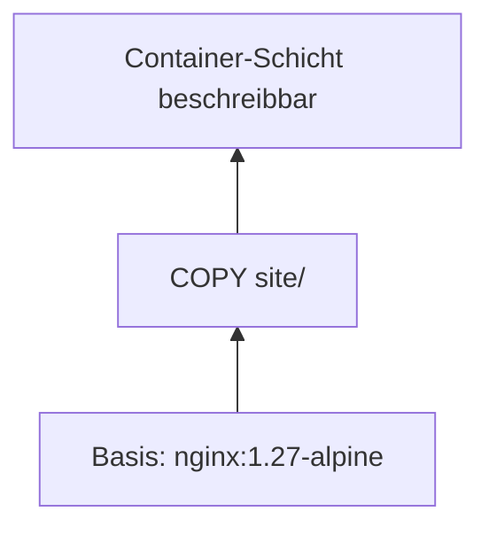

# 05 Docker – Images und Dockerfile
← [[04_Docker-CLI-Befehle]] · → [[06_Docker-Volumes-Verzeichnisse]]

**Inhalt:** [[#1 Image-Namen]] · [[#2 Layer-Prinzip]] · [[#3 Dockerfile-Anweisungen]] · [[#4 Beispiel eigene Webseite]] · [[#5 dockerignore]] · [[#6 Multi-Stage-Build]] · [[#7 Windows-Image (IIS)]] · [[#8 Best Practices]]

---

## 1 Image-Namen
```text
registry.example.com:5000 / team / meinweb : 1.0
└──── Registry ─────────┘   └──Repository──┘ └Tag┘
```
- Ohne Registry → [[Docker-Hub]] (`docker.io`)
- Ohne [[Image-Tag]] → `latest` (nicht „neueste“, nur Standardname!)
- Im Betrieb immer feste Tags: `nginx:1.27-alpine` statt `nginx`

---

## 2 Layer-Prinzip
- Jede Anweisung im [[Dockerfile]] (`RUN`, `COPY`, `ADD`) erzeugt einen [[Image-Layer]].
- Layer werden **gecacht** und zwischen Images **geteilt**.
- Ändert sich ein Layer, werden **alle folgenden** neu gebaut → Reihenfolge: selten Geändertes oben, oft Geändertes unten.



---

## 3 Dockerfile-Anweisungen

| Anweisung | Zweck | Beispiel |
|---|---|---|
| `FROM` | Basis-Image | `FROM nginx:1.27-alpine` |
| `LABEL` | Metadaten | `LABEL maintainer="SveBeh"` |
| `WORKDIR` | Arbeitsverzeichnis | `WORKDIR /app` |
| `COPY` | Dateien aus [[Build-Kontext]] | `COPY site/ /usr/share/nginx/html/` |
| `ADD` | wie COPY + URL/Entpacken | selten nutzen |
| `RUN` | Befehl beim **Bauen** | `RUN apk add --no-cache curl` |
| `ENV` | Umgebungsvariable | `ENV TZ=Europe/Berlin` |
| `ARG` | Variable nur beim Bauen | `ARG VERSION=1.0` |
| `EXPOSE` | dokumentiert Port (öffnet nichts!) | `EXPOSE 80` |
| `USER` | ausführender Benutzer | `USER nginx` |
| `VOLUME` | Mountpunkt markieren | `VOLUME /data` |
| `HEALTHCHECK` | [[Healthcheck]] | siehe unten |
| `CMD` / `ENTRYPOINT` | Befehl beim **Start** | → [[CMD-ENTRYPOINT]] |

---

## 4 Beispiel eigene Webseite

Projektverzeichnis (Maschine: EXA-DOCKER01, `~/projekte/meinweb`):
```text
meinweb/
├── Dockerfile
├── .dockerignore
└── site/
    └── index.html
```

`site/index.html`
```html
<!doctype html>
<html lang="de"><head><meta charset="utf-8"><title>EXAMPLE Web</title></head>
<body><h1>Hallo aus dem Container auf EXA-DOCKER01</h1></body></html>
```

`Dockerfile`
```dockerfile
FROM nginx:1.27-alpine
LABEL maintainer="SveBeh" projekt="EXAMPLE-Lab"
COPY site/ /usr/share/nginx/html/
EXPOSE 80
HEALTHCHECK --interval=30s --timeout=3s CMD wget -q -O /dev/null http://localhost/ || exit 1
```

Bauen und starten:
```bash
# Maschine: EXA-DOCKER01
cd ~/projekte/meinweb
docker build -t meinweb:1.0 .
docker run -d --name meinweb -p 8080:80 meinweb:1.0
docker ps                       # STATUS: (healthy) nach ca. 30 s
curl http://localhost:8080
```

---

## 5 dockerignore
Schließt Dateien vom [[Build-Kontext]] aus (schneller, keine Geheimnisse im Image).
```text
.git
*.log
.env
node_modules
```

---

## 6 Multi-Stage-Build
[[Multi-Stage-Build]]: Bauwerkzeuge nur in Stufe 1, im fertigen Image nur das Ergebnis → kleiner und sicherer.
```dockerfile
# Stufe 1: bauen (mit SDK)
FROM mcr.microsoft.com/dotnet/sdk:8.0 AS build
WORKDIR /src
COPY . .
RUN dotnet publish -c Release -o /app

# Stufe 2: ausführen (nur Runtime)
FROM mcr.microsoft.com/dotnet/aspnet:8.0
WORKDIR /app
COPY --from=build /app .
ENTRYPOINT ["dotnet", "MeineApp.dll"]
```

---

## 7 Windows-Image (IIS)
Nur auf EXA-DOCKER02 bzw. Docker Desktop im Modus *Windows containers*.
```dockerfile
# Basis-Version muss zum Host passen (Server 2025 = ltsc2025) → Prozess-Isolation
FROM mcr.microsoft.com/windows/servercore/iis:windowsservercore-ltsc2025
RUN powershell -Command Remove-Item -Recurse C:\inetpub\wwwroot\*
COPY site/ C:/inetpub/wwwroot/
EXPOSE 80
```
```powershell
# Maschine: EXA-DOCKER02
docker build -t iisweb:1.0 .
docker run -d --name iis01 -p 8080:80 iisweb:1.0
```
> [!note] Versionen
> Host-Build ≠ Image-Build → Start nur mit `--isolation=hyperv` ([[Hyper-V-Isolation]]). Gleiche Version → [[Prozess-Isolation]].

---

## 8 Best Practices
- Kleine Basis-Images (`alpine`, `slim`, `nanoserver`)
- Feste Tags, kein `latest` in Produktion
- `RUN`-Befehle zusammenfassen (`&&`), Cache aufräumen
- Kein Root: `USER`
- Keine Passwörter im Image → Variablen/Secrets
- `.dockerignore` immer anlegen
