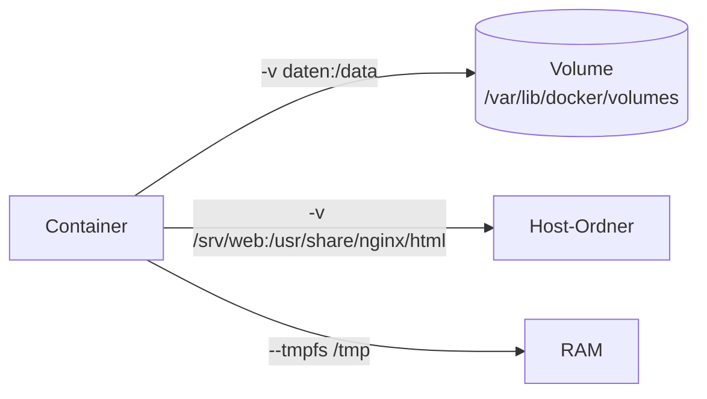

# 06 Docker – Volumes und Verzeichnisse
← [[05_Docker-Images-Dockerfile]] · → [[07_Docker-Netzwerk]]

**Inhalt:** [[#1 Speicherarten]] · [[#2 Volumes]] · [[#3 Bind-Mounts]] · [[#4 Wichtige Verzeichnisse]] · [[#5 Konfigurationsdateien]] · [[#6 Images offline übertragen]] · [[#7 Volume sichern]] · [[#8 Projektstruktur (Empfehlung)]]

---

## 1 Speicherarten

| Art | Ort | Verwaltet von | Einsatz |
|---|---|---|---|
| Container-Schicht | im Container | Docker | temporär – weg nach `docker rm` |
| [[Volume]] | Docker-Datenverzeichnis | Docker | **Datenbanken, dauerhafte Daten** |
| [[Bind-Mount]] | beliebiger Host-Pfad | Admin | Konfig-Dateien, Entwicklung |
| `tmpfs` | RAM (nur Linux) | Docker | temporäre/geheime Daten |



---

## 2 Volumes
```bash
# Maschine: EXA-DOCKER01
docker volume create dbdaten
docker run -d --name db01 -e MARIADB_ROOT_PASSWORD=Lab2026! \
  -v dbdaten:/var/lib/mysql mariadb:11
docker volume inspect dbdaten          # Mountpoint anzeigen
docker rm -f db01                      # Container weg …
docker volume ls                       # … Volume bleibt
```

---

## 3 Bind-Mounts

| Maschine | Beispiel |
|---|---|
| EXA-DOCKER01 (Bash) | `-v /srv/web:/usr/share/nginx/html:ro` |
| Windows-11-PC (PowerShell, Linux-Container) | `-v "${PWD}\site:/usr/share/nginx/html:ro"` |
| EXA-DOCKER02 (Windows-Container) | `-v C:\web:C:\inetpub\wwwroot` |

`:ro` = nur lesen (read-only) → Container kann Host-Dateien nicht ändern.

> [!warning] Leerer Ordner überdeckt Inhalt
> Ein Bind-Mount auf einen Container-Pfad blendet den Original-Inhalt aus. Leerer Host-Ordner → leere Webseite.

---

## 4 Wichtige Verzeichnisse

### EXA-DOCKER01 (Linux)
| Pfad | Inhalt |
|---|---|
| `/var/lib/docker/` | Datenverzeichnis (Data Root) |
| `/var/lib/docker/volumes/` | Volumes |
| `/var/lib/docker/overlay2/` | [[Image-Layer]] (Storage-Treiber overlay2) |
| `/var/lib/docker/containers/<id>/` | Container-Konfig + Logs (`*-json.log`) |
| `/etc/docker/daemon.json` | Daemon-Konfiguration |
| `/var/run/docker.sock` | Socket für die CLI |
| `~/.docker/config.json` | CLI-Konfig, Registry-Anmeldung |

### EXA-DOCKER02 (Windows Server)
| Pfad | Inhalt |
|---|---|
| `C:\ProgramData\docker\` | Datenverzeichnis |
| `C:\ProgramData\docker\volumes\` | Volumes |
| `C:\ProgramData\docker\windowsfilter\` | Image-Layer |
| `C:\ProgramData\docker\config\daemon.json` | Daemon-Konfiguration |
| `\\.\pipe\docker_engine` | Named Pipe für die CLI |
| `%USERPROFILE%\.docker\config.json` | CLI-Konfig |

### Windows-11-PC (Docker Desktop)
| Pfad | Inhalt |
|---|---|
| `%LOCALAPPDATA%\Docker\wsl\` | virtuelle Festplatte (VHDX) mit allen Daten |
| `%USERPROFILE%\.docker\` | CLI-Konfig, `daemon.json` (über GUI bearbeiten) |
| `\\wsl$\docker-desktop\` | Zugriff auf die WSL-Umgebung |
| `%LOCALAPPDATA%\Docker\log\` | Logs von Docker Desktop |

---

## 5 Konfigurationsdateien

`daemon.json` – Beispiel (Maschine: EXA-DOCKER01, `/etc/docker/daemon.json`):
```json
{
  "log-driver": "json-file",
  "log-opts": { "max-size": "10m", "max-file": "3" },
  "dns": ["192.168.10.10"],
  "data-root": "/var/lib/docker"
}
```
```bash
# Maschine: EXA-DOCKER01
sudo systemctl restart docker
docker info | grep -iE 'logging driver|docker root dir'
```
`"dns"` = Lab-DNS (z. B. EXA-DC01) → Container lösen `example.com` auf. IP an dein Lab anpassen.

```powershell
# Maschine: EXA-DOCKER02
notepad C:\ProgramData\docker\config\daemon.json
Restart-Service docker
```

---

## 6 Images offline übertragen
Lab ohne Internet: Image auf Rechner **mit** Internet laden, als Datei mitnehmen.
```powershell
# Maschine: Windows-11-PC (mit Internet)
docker pull nginx:1.27-alpine
docker save -o C:\Transfer\nginx_1.27-alpine.tar nginx:1.27-alpine
```
```bash
# Maschine: EXA-DOCKER01 (Datei per scp/USB übertragen)
docker load -i nginx_1.27-alpine.tar
docker images nginx
```
Vergleich: [[HyperV-VM-Export-Import]] (VM als Datei) ↔ `save/load` (Image als Datei).

---

## 7 Volume sichern
```bash
# Maschine: EXA-DOCKER01 – Volume "dbdaten" als tar.gz sichern
docker run --rm -v dbdaten:/quelle:ro -v "$PWD":/backup alpine \
  tar czf /backup/dbdaten_$(date +%F).tar.gz -C /quelle .

# Wiederherstellen in neues Volume
docker volume create dbdaten_neu
docker run --rm -v dbdaten_neu:/ziel -v "$PWD":/backup alpine \
  tar xzf /backup/dbdaten_2026-10-12.tar.gz -C /ziel
```
> [!tip] Datenbanken
> Konsistentes Backup besser mit Datenbank-Werkzeug (`mariadb-dump`) oder bei gestopptem Container.

---

## 8 Projektstruktur (Empfehlung)
```text
~/projekte/                  (EXA-DOCKER01)
└── laborweb/
    ├── compose.yaml         → [[08_Docker-Compose]]
    ├── .env                 Passwörter (nicht ins Git!)
    ├── .gitignore
    ├── web/
    │   ├── Dockerfile
    │   └── site/index.html
    └── backup/
```
