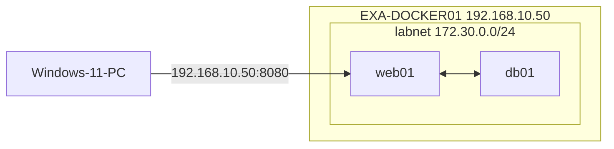

# 07 Docker – Netzwerk
← [[06_Docker-Volumes-Verzeichnisse]] · → [[08_Docker-Compose]]

**Inhalt:** [[#1 Netzwerktreiber]] · [[#2 Standard-Bridge]] · [[#3 Eigenes Bridge-Netz mit DNS]] · [[#4 Port-Mapping]] · [[#5 Windows-Container-Netze]] · [[#6 Firewall]] · [[#7 Diagnose]]

---

## 1 Netzwerktreiber

| Treiber | Verhalten | Einsatz |
|---|---|---|
| `bridge` | privates Netz mit NAT, Standard | Einzelhost, Compose |
| `host` | Container nutzt Host-Netz direkt (nur Linux) | Performance, Netzwerk-Tools |
| `none` | kein Netz | Isolation |
| `macvlan` | eigene MAC/IP im LAN | Container wie physisches Gerät |
| `overlay` | über mehrere Hosts | Swarm/Cluster |
| `nat` | Standard bei [[Windows-Container|Windows-Containern]] | Windows |
| `transparent` | Container direkt im Hyper-V-Switch-Netz | Windows |

---

## 2 Standard-Bridge
- Linux: Schnittstelle `docker0`, Netz meist `172.17.0.0/16`, Gateway `172.17.0.1`
- Container erreichen Internet per NAT über den Host
- **Keine Namensauflösung** zwischen Containern → nur per IP

```bash
# Maschine: EXA-DOCKER01
ip addr show docker0
docker network inspect bridge --format '{{json .IPAM.Config}}'
```

---

## 3 Eigenes Bridge-Netz mit DNS
In einem eigenen [[Bridge-Netzwerk]] lösen Container sich **per Name** auf (eingebauter DNS `127.0.0.11`).

```bash
# Maschine: EXA-DOCKER01
docker network create --subnet 172.30.0.0/24 labnet
docker run -d --name web01 --network labnet nginx:1.27-alpine
docker run --rm --network labnet alpine ping -c 2 web01        # Name funktioniert
docker run --rm alpine ping -c 2 web01                         # Standard-Bridge: Fehler
```



---

## 4 Port-Mapping
[[Port-Mapping]] macht Container-Ports von außen erreichbar.

| Angabe | Bedeutung |
|---|---|
| `-p 8080:80` | Host-Port 8080 (alle IPs) → Container 80 |
| `-p 127.0.0.1:8080:80` | nur lokal erreichbar |
| `-p 5353:53/udp` | UDP |
| `-P` | alle `EXPOSE`-Ports auf zufällige Host-Ports |

> [!important] EXPOSE ≠ veröffentlichen
> `EXPOSE` im [[Dockerfile]] ist nur Dokumentation. Erreichbar wird ein Port erst durch `-p`.

---

## 5 Windows-Container-Netze
```powershell
# Maschine: EXA-DOCKER02
docker network ls                                   # Standard: "nat"
Get-NetNat                                          # NAT-Regel von Docker
Get-HnsNetwork | Select Name, Type, Subnets         # Host Network Service (falls Modul vorhanden)
```
Container-IPs im `nat`-Netz sind nur auf dem Host direkt erreichbar → von außen per `-p`.

---

## 6 Firewall
- Linux: Docker schreibt eigene **iptables/nftables-Regeln**. Veröffentlichte Ports umgehen dabei oft `ufw`! → Ports gezielt an IP binden (`-p 127.0.0.1:…`).
- Windows: Für `-p` Freigabe in der Windows-Firewall prüfen:
```powershell
# Maschine: EXA-DOCKER02
New-NetFirewallRule -DisplayName 'Docker Web 8080' -Direction Inbound -Protocol TCP -LocalPort 8080 -Action Allow
```

---

## 7 Diagnose
```bash
# Maschine: EXA-DOCKER01
docker network inspect labnet                       # welche Container, welche IPs
docker exec web01 cat /etc/resolv.conf              # DNS im Container
docker run --rm --network labnet nicolaka/netshoot nslookup web01   # Netzwerk-Werkzeugkasten
sudo ss -tlnp | grep 8080                           # lauscht der Host-Port?
```
```powershell
# Maschine: Windows-11-PC
Test-NetConnection EXA-DOCKER01 -Port 8080
```
