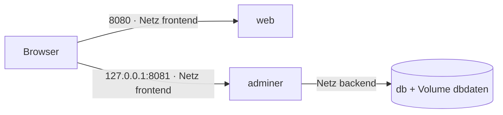

# 08 Docker Compose
← [[07_Docker-Netzwerk]] · → [[09_Docker-Praxis-Lab]]

**Inhalt:** [[#1 Wozu Compose]] · [[#2 YAML-Regeln]] · [[#3 Beispiel Web + DB + Adminer]] · [[#4 Befehle]] · [[#5 Wichtige Schlüssel]] · [[#6 Typische Fehler]]

---

## 1 Wozu Compose
- [[Docker-Compose]] beschreibt **mehrere Container, Netze, Volumes** in einer Datei: `compose.yaml`.
- Ein Befehl startet alles: `docker compose up -d`.
- Datei liegt im Git → Infrastruktur als Code, wiederholbar.
- Compose v2: `docker compose` (Leerzeichen). Alt: `docker-compose`. Der Schlüssel `version:` ist veraltet.

---

## 2 YAML-Regeln
- Einrückung mit **Leerzeichen**, nie Tabs (2 Leerzeichen üblich)
- `schluessel: wert` – Leerzeichen nach dem Doppelpunkt
- Liste mit `- `
- Strings mit Sonderzeichen in Anführungszeichen: `"8080:80"`

---

## 3 Beispiel Web + DB + Adminer
Maschine: EXA-DOCKER01, Ordner `~/projekte/laborweb/`

`.env`
```ini
MARIADB_ROOT_PASSWORD=Lab2026!Root
MARIADB_DATABASE=labor
MARIADB_USER=labuser
MARIADB_PASSWORD=Lab2026!User
WEB_PORT=8080
```

`compose.yaml`
```yaml
name: laborweb

services:
  web:
    build: ./web                     # Dockerfile aus Kapitel 05
    image: meinweb:1.0
    ports:
      - "${WEB_PORT}:80"
    networks: [frontend]
    restart: unless-stopped

  db:
    image: mariadb:11
    environment:
      MARIADB_ROOT_PASSWORD: ${MARIADB_ROOT_PASSWORD}
      MARIADB_DATABASE: ${MARIADB_DATABASE}
      MARIADB_USER: ${MARIADB_USER}
      MARIADB_PASSWORD: ${MARIADB_PASSWORD}
    volumes:
      - dbdaten:/var/lib/mysql
    networks: [backend]
    restart: unless-stopped
    healthcheck:
      test: ["CMD", "healthcheck.sh", "--connect", "--innodb_initialized"]
      interval: 10s
      timeout: 5s
      retries: 5

  adminer:
    image: adminer:latest
    ports:
      - "127.0.0.1:8081:8080"        # nur lokal erreichbar
    networks: [frontend, backend]
    depends_on:
      db:
        condition: service_healthy
    restart: unless-stopped

volumes:
  dbdaten:

networks:
  frontend:
  backend:
```


`db` ist **nicht** von außen erreichbar (keine `ports`, nur Netz `backend`).

---

## 4 Befehle

| Befehl (Maschine: EXA-DOCKER01, im Projektordner) | Zweck |
|---|---|
| `docker compose config` | Datei prüfen, Variablen eingesetzt anzeigen |
| `docker compose up -d` | alles bauen/starten |
| `docker compose up -d --build` | Images neu bauen |
| `docker compose ps` | Status |
| `docker compose logs -f db` | Logs eines Dienstes |
| `docker compose exec db mariadb -u root -p` | Befehl im Dienst |
| `docker compose restart web` | Dienst neu starten |
| `docker compose pull` | neue Image-Versionen holen |
| `docker compose down` | stoppen + Container/Netze löschen |
| `docker compose down -v` | **zusätzlich Volumes löschen** ⚠ |

---

## 5 Wichtige Schlüssel

| Schlüssel | Bedeutung |
|---|---|
| `image` / `build` | fertiges Image / selbst bauen |
| `ports` | [[Port-Mapping]] |
| `volumes` | [[Volume]] oder [[Bind-Mount]] |
| `environment` / `env_file` | Variablen |
| `networks` | Netzzugehörigkeit |
| `depends_on` | Startreihenfolge (mit `condition: service_healthy` echtes Warten) |
| `restart` | [[Restart-Policy]] |
| `healthcheck` | [[Healthcheck]] |
| `deploy.resources.limits` | CPU/RAM-Grenzen |

---

## 6 Typische Fehler

| Meldung | Ursache | Lösung |
|---|---|---|
| `yaml: line X: found character that cannot start any token` | Tab statt Leerzeichen | Tabs ersetzen |
| `port is already allocated` | Host-Port belegt | anderen Port in `.env` |
| `variable is not set` | `.env` fehlt/falscher Ordner | im Projektordner ausführen |
| Web kann DB nicht erreichen | verschiedene Netze | gemeinsames Netz |
