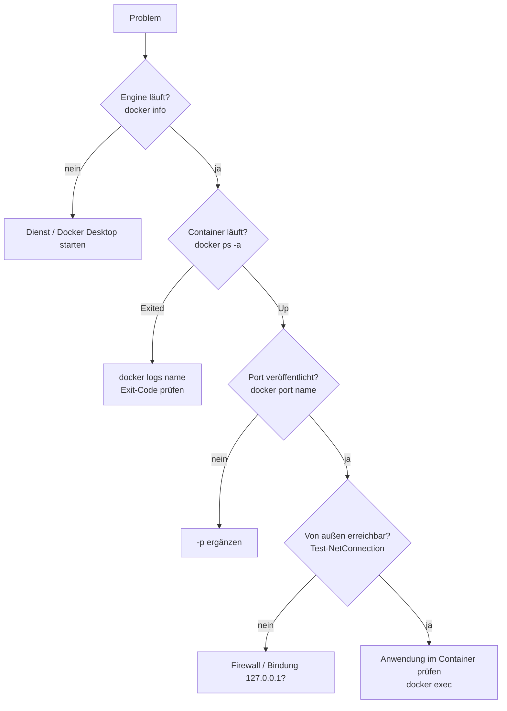

# 10 Docker – Troubleshooting
← [[09_Docker-Praxis-Lab]] · → [[11_Docker-Aufgaben]]

## Vorgehen

## Fehlertabelle

| Meldung / Symptom | Maschine | Ursache | Lösung |
|---|---|---|---|
| `error during connect … pipe/docker_engine` | Windows-11-PC | Docker Desktop nicht gestartet | Docker Desktop starten |
| `Cannot connect to the Docker daemon at unix:///var/run/docker.sock` | EXA-DOCKER01 | Dienst aus | `sudo systemctl start docker` |
| `permission denied … docker.sock` | EXA-DOCKER01 | nicht in Gruppe `docker` | `sudo usermod -aG docker $USER`, neu anmelden |
| `port is already allocated` | alle | Host-Port belegt | `docker ps`, anderen Port |
| `pull access denied` / `manifest unknown` | alle | Name/Tag falsch oder Login fehlt | Schreibweise, `docker login` |
| `dial tcp: lookup registry-1.docker.io` | Lab | kein Internet/DNS | Offline-Transfer `save/load` |
| Container sofort `Exited (0)` | alle | Hauptprozess beendet | Vordergrund-Prozess in `CMD` |
| `Exited (1)` | alle | Anwendungsfehler | `docker logs <name>` |
| `Exited (137)` | alle | gekillt, oft Speichermangel (OOM) | `--memory` erhöhen, `docker inspect` → `OOMKilled` |
| `no matching manifest for windows/amd64` | EXA-DOCKER02 | Linux-Image auf Windows-Engine | Windows-Image nutzen |
| `container operating system does not match the host` | EXA-DOCKER02 | falsche Windows-Version | passendes `ltsc`-Tag oder `--isolation=hyperv` |
| `WSL 2 installation is incomplete` | Windows-11-PC | WSL fehlt/veraltet | `wsl --update` |
| Festplatte voll | alle | alte Images/Layer | `docker system df`, `docker system prune` |

## Werkzeuge

| Befehl | Zweck |
|---|---|
| `docker logs -f --tail 100 <name>` | Anwendungslogs |
| `docker inspect <name> --format '{{.State.ExitCode}} {{.State.OOMKilled}}'` | Grund des Beendens |
| `docker events` | Ereignisse live |
| `journalctl -u docker -f` | Daemon-Log (EXA-DOCKER01) |
| `Get-WinEvent -LogName Application -MaxEvents 30 \| ? ProviderName -eq docker` | Daemon-Log (EXA-DOCKER02) |
| Docker Desktop → 🐞 *Troubleshoot* | Diagnose, Neustart, Reset (Windows-11-PC) |
