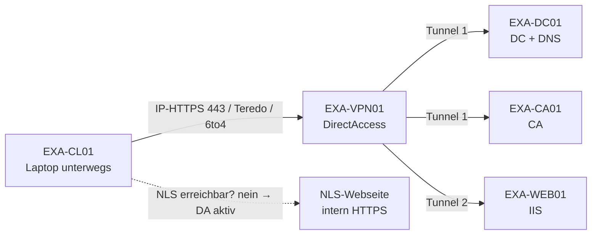

# DirectAccess vs. VPN

> [!abstract] Kernaussage
> - **[[VPN]]**: Tunnel wird für den **Benutzer** aufgebaut (manuell oder automatisch).
> - **DirectAccess**: Tunnel wird für den **Computer** aufgebaut – automatisch, **vor** der Anmeldung.
> - DirectAccess ist **veraltet**; Nachfolger von Microsoft: **Always On VPN**.

Thema: [[Netzwerk]] · [[Windows Server]]
Verwandt: [[PKI und Zertifikatdienste]] · [[PKI und Zertifikatdienste#Autoenrollment (GPO)|GPO-Autoenrollment]] · [[AD DS Überblick]] · [[RADIUS und NPS]] · Übung: [[Lab VPN SSTP mit MS-CHAPv2]]


## VPN-Protokolle – Übersicht

| Protokoll             | Vollständiger Name                                                     | Port/Basis                                         | Verschlüsselung                    | Bewertung                                    | Computer<br>Authentif. |
| --------------------- | ----------------------------------------------------------------------- | -------------------------------------------------- | ----------------------------------- | -------------------------------------------- | ---------------------- |
| [[PPTP]] / [[MPPE]]   | Point-to-Point Tunneling Protocol / Microsoft Point-to-Point Encryption | [[TCP]] 1723 + GRE (Generic Routing Encapsulation) | MPPE (RC4, bis 128 Bit)             | veraltet, unsicher – nicht mehr nutzen       | Nein                   |
| [[L2TP]] (/[[IPsec]]) | Layer 2 Tunneling Protocol (/ Internet Protocol Security)               | [[UDP]] 1701, 500, 4500                            | keine eigene → mit IPsec kombiniert | ok, aber [[NAT]]-/Firewall-Probleme          | Ja                     |
| [[SSTP]]              | Secure Socket Tunneling Protocol                                        | TCP 443 ([[SSL]]/[[TLS]])                          | SSL/TLS                             | firewallfreundlich, Windows-lastig           | Ja                     |
| [[IKEv2]] (/IPsec)    | Internet Key Exchange version 2 (/ IPsec)                               | UDP 500, 4500                                      | IPsec ([[AES]])                     | modern, stabil, schneller Reconnect (MOBIKE) | Ja                     |

## Authentifizierungs-Protokolle – Übersicht

| Protokoll    | Vollständiger Name                                   | Prinzip                                                       | Sicherheit                              | Bewertung                         |
| ------------ | ----------------------------------------------------- | ------------------------------------------------------------- | --------------------------------------- | --------------------------------- |
| PAP          | Password Authentication Protocol                      | Passwort im Klartext übertragen                              | keine (Klartext)                        | unsicher – nie nutzen             |
| SPAP         | Shiva Password Authentication Protocol                | Passwort verschlüsselt (Shiva)                               | schwach, reversibel                     | veraltet, unsicher                |
| CHAP         | Challenge Handshake Authentication Protocol           | Challenge-Response (MD5-Hash)                                 | mittel, Klartext-PW nötig auf Server   | besser als PAP, aber MD5 schwach  |
| MS-CHAP (v2) | Microsoft Challenge Handshake Authentication Protocol | Challenge-Response, gegenseitige Auth (v2)                    | mittel, gegen moderne Angriffe knackbar | nur mit Tunnel (z. B. PEAP/IPsec) → [[MS-CHAPv2]] |
| EAP          | Extensible Authentication Protocol                    | Rahmenwerk für viele Verfahren (TLS, Zertifikate, Smartcard) | hoch (je nach Methode, z. B. EAP-TLS)   | modern, Standard bei 802.1X/[[WLAN]]  |

> [!tip] Merke
> PEAP baut erst einen [[TLS]]-Tunnel (Serverzertifikat!) auf, **darin** läuft MS-CHAPv2 → Passwort-Hash nicht abgreifbar. Zentrale Prüfung: [[RADIUS und NPS]].

---

## 1. Grundidee

| | DirectAccess | VPN |
|---|---|---|
| Idee | „Immer im Firmennetz“ – Laptop verhält sich unterwegs wie im Büro | „Bei Bedarf ins Firmennetz“ – Benutzer verbindet sich |
| Wer baut auf? | Computer (Systemdienst) | Benutzer (Client-Software) |
| Wann? | Sobald Internet da ist, vor Logon | Nach Logon, bei Bedarf |
| Eingeführt | Server 2008 R2 / Windows 7 | Seit Jahrzehnten, herstellerunabhängig |

---

## 2. Gegenüberstellung

| Kriterium | DirectAccess | VPN (klassisch) | Always On VPN |
|---|---|---|---|
| Clients | Windows Enterprise/Education, **domänengebunden** | Beliebiges OS | Windows 10/11 (Device Tunnel nur Enterprise) |
| Protokoll | IPsec über [[IPv6]] | PPTP, L2TP/IPsec, SSTP, IKEv2, OpenVPN, WireGuard | IKEv2, SSTP |
| IPv6-Übergänge | [[6to4]], [[Teredo]], **[[IP-HTTPS]]** | nicht nötig | nicht nötig |
| Authentifizierung | Computerzertifikat + Computerkonto (Tunnel 1), + [[Kerberos]] Benutzer (Tunnel 2) | Benutzer: Passwort, [[MFA]], Zertifikat | Gerätezertifikat (Device Tunnel) + Benutzer (User Tunnel) |
| [[PKI]] | Vollbereitstellung: **Pflicht**. Vereinfachter Assistent: Kerberos-Proxy + selbstsigniertes Zertifikat (nur Win 8+, kein 2FA) | Optional (Serverzertifikat bei SSTP/IKEv2) | Praktisch Pflicht |
| Verwaltung Client | **[[GPO]]** | Manuell / Skript | Intune, [[SCCM]], PowerShell (ProfileXML) |
| GPO/Updates unterwegs | Ja, dauerhaft | Nur bei aktivem Tunnel | Ja (Device Tunnel) |
| Split-Tunneling | Standard (über [[NRPT]]) | Konfigurierbar | Konfigurierbar |
| Serverrolle | Remote Access → DirectAccess | Remote Access → [[RRAS]], oder Firewall/Appliance | RRAS + [[NPS]] |
| Status | **Deprecated** | Aktiv | Aktiv, Empfehlung von Microsoft |

---

## 3. DirectAccess – Bausteine

| Baustein | Zweck |
|---|---|
| **DirectAccess-Server** | Tunnel-Endpunkt, meist in [[DMZ]] hinter Edge-Firewall |
| **[[NLS]]** (Network Location Server) | Interne [[HTTPS]]-Seite. Erreichbar → Client ist **intern**, [[DA]] bleibt aus |
| **NRPT** (Name Resolution Policy Table) | Leitet [[DNS]]-Anfragen für `example.com` in den Tunnel |
| **[[DNS64]]/[[NAT64]]** | Übersetzt IPv6-Client ↔ [[IPv4]]-only-Server intern |
| **Tunnel 1 (Infrastruktur)** | Computer → [[DC]], DNS, [[CA]], [[WSUS]]. **Vor** Logon |
| **Tunnel 2 (Intranet)** | Benutzer → Fileserver, Web usw. **Nach** Logon |



### Ports

| Technik | Port/Protokoll |
|---|---|
| [[IP]]-HTTPS | TCP 443 |
| Teredo | UDP 3544 |
| 6to4 | IP-Protokoll 41 |
| IKEv2 / L2TP-IPsec | UDP 500, 4500 (L2TP zusätzlich UDP 1701) |
| SSTP | TCP 443 |
| PPTP | TCP 1723 + GRE (**unsicher, nicht verwenden**) |
| WireGuard | UDP 51820 (Standard) |

---

## 4. Warum Computerzertifikat?

- Tunnel entsteht **vor der Benutzeranmeldung** → kein Benutzer, keine Benutzer-Anmeldedaten.
- Der Computer muss sich selbst ausweisen → **Computerzertifikat** aus der eigenen CA.
- Verteilung: **GPO-Autoenrollment** (Vorlage „Computer“ bzw. eigene Kopie, Berechtigung *Autoregistrieren* für Domänencomputer).

---

## 5. Vor- und Nachteile

| | Vorteile | Nachteile |
|---|---|---|
| DirectAccess | Transparent für Benutzer · GPO/Patches auch unterwegs · Anmeldung mit abgelaufenem Passwort möglich | Nur Windows Enterprise · IPv6-Komplexität · PKI/NLS-Aufwand · Deprecated |
| Klassisches VPN | Einfach, plattformunabhängig · viele Protokolle · günstig | Benutzer muss verbinden · keine Verwaltung ohne Tunnel · Probleme bei abgelaufenem Passwort |
| Always On VPN | Automatisch wie DA · IPv4 möglich · Intune-fähig · auch nicht domänengebunden | Konfiguration (ProfileXML) anspruchsvoll · PKI nötig |

---

## 6. Praxis: PowerShell-Validierung

### Rolle installieren
```powershell
# Maschine: EXA-VPN01
Install-WindowsFeature RemoteAccess, DirectAccess-VPN -IncludeManagementTools
```

### Server prüfen
```powershell
# Maschine: EXA-VPN01
Get-RemoteAccess                        # Status DA / VPN
Get-DAServer                            # DirectAccess-Serverkonfiguration
Get-DAClient                            # Welche Sicherheitsgruppe DA bekommt
Get-RemoteAccessConnectionStatistics    # Aktive Verbindungen
```

### Client prüfen (DirectAccess)
```powershell
# Maschine: EXA-CL01
Get-DAConnectionStatus                  # ConnectedRemotely / ConnectedLocally
Get-NetIPHttpsState                     # IP-HTTPS aktiv?
Get-NetTeredoState
Get-DnsClientNrptPolicy                 # NRPT-Einträge aus GPO
Get-ChildItem Cert:\LocalMachine\My     # Computerzertifikat vorhanden?
```

### Client (klassisches VPN)
```powershell
# Maschine: EXA-CL01
Add-VpnConnection -Name "EXA-VPN" -ServerAddress "vpn.example.com" `
  -TunnelType Sstp -AuthenticationMethod MSChapv2 -RememberCredential
Get-VpnConnection
rasdial "EXA-VPN"                       # verbinden
rasdial "EXA-VPN" /disconnect
```

---

## 7. Aufgaben

### Aufgabe 1 (Verständnis)
Warum braucht DirectAccess ein **Computer**zertifikat und nicht nur ein Benutzerzertifikat?

> [!success]- Lösung
> Tunnel 1 wird vor der Benutzeranmeldung aufgebaut. Es gibt noch keinen Benutzer, also muss sich der Computer selbst authentifizieren. Verteilung per GPO-Autoenrollment.

### Aufgabe 2 (Szenario)
Mitarbeiter im Homeoffice, Passwort abgelaufen. Er startet den Laptop.
Was passiert mit DirectAccess, was mit klassischem VPN?

> [!success]- Lösung
> - **DirectAccess**: Tunnel 1 steht schon beim Anmeldebildschirm → DC erreichbar → Passwort kann direkt geändert werden.
> - **Klassisches VPN**: Anmeldung erfolgt nur mit zwischengespeicherten Anmeldedaten. DC nicht erreichbar → Passwortänderung scheitert, VPN-Anmeldung ggf. abgelehnt. Lösung: Helpdesk oder **Device Tunnel** (Always On VPN).

### Aufgabe 3 (Funktion)
Ein Laptop mit DirectAccess steht im Büro. Woran erkennt er, dass er DirectAccess **nicht** nutzen soll?

> [!success]- Lösung
> Er erreicht den **NLS** per HTTPS → Client ist intern → DirectAccess-Regeln (NRPT) werden deaktiviert.

### Aufgabe 4 (Ports)
Hotel-WLAN erlaubt nur TCP 80 und 443. Welche Techniken funktionieren?

> [!success]- Lösung
> DirectAccess über **IP-HTTPS**, VPN über **SSTP**. IKEv2, L2TP, Teredo, 6to4 scheitern.

### Aufgabe 5 (Entscheidung)
Firma mit 50 Laptops (Windows 11 Pro, teils nicht in der Domäne) plant 2026 Remote-Zugriff. Empfehlung?

> [!success]- Lösung
> **Always On VPN**. DirectAccess scheidet aus: deprecated, nur Enterprise/Education, nur domänengebunden.

### Aufgabe 6 (Praxis, EXA-CL01)
Prüfe per PowerShell, ob der Client ein Computerzertifikat von EXA-CA01 besitzt.

> [!success]- Lösung
> ```powershell
> # Maschine: EXA-CL01
> Get-ChildItem Cert:\LocalMachine\My |
>   Where-Object Issuer -like "*EXA-CA01*" |
>   Select-Object Subject, Issuer, NotAfter, Thumbprint
> ```

---

## 8. Mini-Klausur (20 Punkte, 15 Min)

1. Nenne je zwei Unterschiede zwischen DirectAccess und VPN bei Clientvoraussetzungen und Verbindungsaufbau. **(4 P)**
2. Erkläre die Funktion von NLS und NRPT. **(4 P)**
3. Nenne die drei IPv6-Übergangstechniken von DirectAccess mit Port/Protokoll. **(3 P)**
4. Warum ist PPTP nicht mehr einzusetzen? **(2 P)**
5. Beschreibe Tunnel 1 und Tunnel 2 bei DirectAccess. **(4 P)**
6. Welchen Nachfolger empfiehlt Microsoft und welche zwei Tunneltypen hat er? **(3 P)**

> [!success]- Lösungsskizze
> 1. DA: nur Windows Enterprise/Education + domänengebunden; VPN: jedes OS. DA: automatisch vor Logon durch Computer; VPN: manuell nach Logon durch Benutzer.
> 2. NLS: interne HTTPS-Seite zur Standorterkennung (intern/extern). NRPT: Tabelle, die DNS-Anfragen für interne Namensräume in den Tunnel leitet.
> 3. 6to4 (IP-Protokoll 41), Teredo (UDP 3544), IP-HTTPS (TCP 443).
> 4. Veraltete Verschlüsselung ([[MS-CHAPv2]]/MPPE) ist geknackt → keine Vertraulichkeit.
> 5. Tunnel 1: Infrastruktur (DC, DNS, CA), Computerzertifikat + Computerkonto, vor Logon. Tunnel 2: Intranet, zusätzlich Kerberos des Benutzers, nach Logon.
> 6. Always On VPN: **Device Tunnel** (Gerät, vor Logon) und **User Tunnel** (Benutzer, nach Logon).

---

## 9. Merksätze
- DirectAccess = **Computer** verbindet, **vor** Logon, **IPv6/IPsec**, **PKI + GPO**.
- VPN = **Benutzer** verbindet, **nach** Logon, plattformunabhängig.
- Heute: **Always On VPN** statt DirectAccess.

## 📄 Unterlagen
- Buch 70-741: [[70-741_Server2016_Netzwerk.pdf#page=194|VPN im Überblick]] · [[70-741_Server2016_Netzwerk.pdf#page=196|Protokolle + Authentifizierung]] · [[70-741_Server2016_Netzwerk.pdf#page=199|Remotezugriff-VPN]] · [[70-741_Server2016_Netzwerk.pdf#page=213|Site-to-Site-VPN]] · [[70-741_Server2016_Netzwerk.pdf#page=222|DirectAccess]] · [[70-741_Server2016_Netzwerk.pdf#page=282|IPv6-Übergänge (ISATAP, Teredo)]]
- Buch 70-642: [[70-642_Server2008R2_Netzwerk.pdf#page=422|Remotenetzwerke/VPN]] · [[70-642_Server2008R2_Netzwerk.pdf#page=447|DirectAccess]]
- Prüfungsfragen: [[VPN-RADIUS_15_Pruefungsfragen.pdf#page=1|VPN/RADIUS 15]] · [[VPN-RADIUS_15_Pruefungsfragen_Loesung.pdf#page=7|Lösungen]] · [[AD-CS_20_Pruefungsfragen.pdf#page=6|Szenario gestohlenes VPN-Notebook]]
