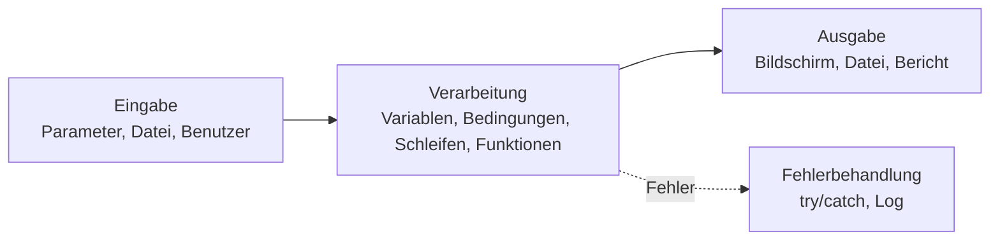

# PowerShell-Scripting – Kapitelübersicht

> [!info] Lernziel
> Eigene PowerShell-Skripte schreiben, die Admin-Aufgaben automatisieren: lesen, entscheiden, wiederholen, Fehler abfangen, protokollieren – sicher und wiederverwendbar.

> [!example] Für Kinder erklärt – Was ist Programmieren?
> Ein Computer ist wie ein sehr fleißiger, aber sehr wörtlicher Roboter. Er macht **genau** das, was auf seinem Zettel steht – nicht mehr, nicht weniger. Programmieren heißt: diesen Zettel so schreiben, dass der Roboter Schritt für Schritt das Richtige tut. Ein **Skript** ist dieser Zettel.

## Lernpfad

| Nr. | Notiz | Inhalt | Zeit |
|---|---|---|---|
| 01 | [[01_PS-Grundlagen]] | Konsole, Editor, Hilfe, Cmdlets | 60 Min |
| 02 | [[02_PS-Variablen-Datentypen]] | Variablen, Text, Zahlen, Arrays, Hashtables | 60 Min |
| 03 | [[03_PS-Operatoren]] | Rechnen, Vergleichen, Verknüpfen | 45 Min |
| 04 | [[04_PS-Objekte-Pipeline]] | Objekte, Pipeline, Filtern, Sortieren | 90 Min |
| 05 | [[05_PS-Bedingungen]] | if, else, switch | 60 Min |
| 06 | [[06_PS-Schleifen]] | foreach, for, while | 60 Min |
| 07 | [[07_PS-Funktionen-Parameter]] | eigene Befehle bauen | 90 Min |
| 08 | [[08_PS-Fehlerbehandlung-Debugging]] | try/catch, Logging, Haltepunkte | 60 Min |
| 09 | [[09_PS-Dateien-Daten]] | Dateien, CSV, JSON | 60 Min |
| 10 | [[10_PS-Skripte-Module-Sicherheit]] | .ps1, Module, Ausführungsrichtlinie, Aufgabenplanung | 60 Min |
| 11 | [[11_PS-Remoting]] | Befehle auf anderen Servern | 60 Min |
| 12 | [[12_PS-Praxis-Lab]] | AD-Benutzer aus CSV, Systembericht, Tests | 120 Min |
| 13 | [[13_PS-Stil-Best-Practices]] | sauberer Code, PSScriptAnalyzer | 30 Min |
| 14 | [[14_PS-Aufgaben]] | Übungen mit Lösungen | 90 Min |
| 15 | [[15_PS-Klausur]] | Prüfung | 60 Min |

## Lab-Maschinen

| Maschine | PowerShell | Zweck |
|---|---|---|
| Schul-PC (Server 2022) | 5.1 | Grundlagen, Dateien, Vault |
| EXA-DC01 (Server 2025) | 5.1 | Active-Directory-Skripte |
| Hyper-V-Host | 5.1 | VM-Berichte, Remoting-Quelle |
| EXA-SRV01, EXA-SRV02 | 5.1 | Ziele für Remoting |

> [!note] Version
> Alle Beispiele laufen in **Windows PowerShell 5.1** (auf jedem Windows Server vorhanden). Abweichungen für **PowerShell 7** sind gekennzeichnet.

## Der Programmier-Werkzeugkasten

Jedes Skript folgt diesem **EVA-Prinzip**: Eingabe → Verarbeitung → Ausgabe.

## Begriffe des Kapitels
[[PowerShell]] · [[Cmdlet]] · [[Verb-Nomen]] · [[PS-Skript]] · [[Syntax]] · [[Algorithmus]] · [[Kommentar]] · [[Variable]] · [[Datentyp]] · [[Array]] · [[Hashtable]] · [[Objekt]] · [[Eigenschaft]] · [[Methode]] · [[Operator]] · [[PS-Pipeline]] · [[Bedingung]] · [[Schleife]] · [[Funktion]] · [[Parameter]] · [[CmdletBinding]] · [[Splatting]] · [[Scriptblock]] · [[Try-Catch]] · [[Debugging]] · [[PS-Alias]] · [[PS-Provider]] · [[PS-Profil]] · [[PS-Modul]] · [[Execution-Policy]] · [[Kommentarbasierte-Hilfe]] · [[PS-Remoting]] · [[WinRM]] · [[PSSession]] · [[Pester]] · [[PSScriptAnalyzer]]

Übersicht: [[00_Glossar-Index]]

## Bezug zu anderen Themen
- [[HyperV-VM-Export-Import]] – Hyper-V per PowerShell
- [[00_Docker-Uebersicht]] – Docker-CLI in PowerShell
- [[CI-CD]] – Skripte automatisch testen
- [[AD DS]] · [[CLI]] · [[API]]
