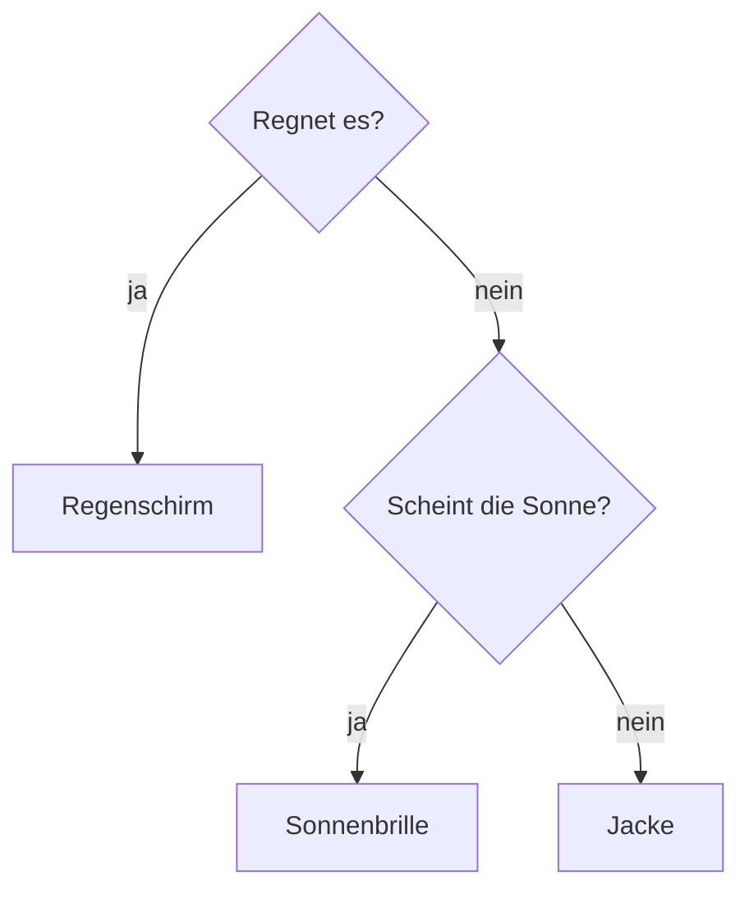

# 05 PowerShell – Bedingungen
← [[04_PS-Objekte-Pipeline]] · → [[06_PS-Schleifen]]

**Inhalt:** [[#1 Idee]] · [[#2 if, elseif, else]] · [[#3 switch]] · [[#4 Was zählt als wahr]] · [[#5 Praxisbeispiel]] · [[#6 Kontrollfragen]]

---

## 1 Idee

> [!example] Für Kinder erklärt
> Eine [[Bedingung]] ist eine **Weggabelung**. Der Roboter fragt: „**Regnet** es?“ – **Wenn ja**, nimm den Regenschirm. **Sonst**, nimm die Sonnenbrille. Er geht immer nur **einen** Weg.



---

## 2 if, elseif, else
```powershell
# Maschine: Schul-PC
$frei = (Get-PSDrive C).Free / 1GB

if ($frei -lt 10) {
    Write-Warning "Nur noch $([math]::Round($frei,1)) GB frei!"
}
elseif ($frei -lt 30) {
    Write-Host "Knapp: $([math]::Round($frei,1)) GB" -ForegroundColor Yellow
}
else {
    Write-Host 'Genug Platz.' -ForegroundColor Green
}
```

Aufbau:
```text
if (Bedingung) { … }        ← wird geprüft, Ergebnis True/False
elseif (Bedingung) { … }    ← nur, wenn die erste falsch war (beliebig oft)
else { … }                  ← wenn nichts davon zutraf (optional)
```

Kombiniert mit Logik-Operatoren → [[03_PS-Operatoren#3 Logik]]:
```powershell
# Maschine: Schul-PC
if ((Test-Path C:\Skripte) -and -not (Test-Path C:\Skripte\log)) {
    New-Item C:\Skripte\log -ItemType Directory | Out-Null
}
```

---

## 3 switch
Für **viele mögliche Werte** übersichtlicher als lange `elseif`-Ketten.

> [!example] Für Kinder erklärt
> `switch` ist wie ein **Getränkeautomat**: Du drückst Taste 1 → Wasser, Taste 2 → Saft, Taste 3 → Kakao, jede andere Taste → „Ungültig“.

```powershell
# Maschine: Schul-PC
$rolle = 'DC'
switch ($rolle) {
    'DC'   { 'Domain Controller – nur umziehen, nie klonen!' }
    'WEB'  { 'Webserver – IIS prüfen' }
    'DB'   { 'Datenbank – Backup prüfen' }
    default { "Unbekannte Rolle: $rolle" }
}
```

Mit Platzhaltern und Regex:
```powershell
# Maschine: Schul-PC
switch -Wildcard ($env:COMPUTERNAME) {
    'EXA-*' { 'Lab EXAMPLE' }
    'CON-*' { 'Lab contoso' }
    default { 'anderes Netz' }
}
```
`switch` prüft **alle** Fälle; mit `break` im Block stoppt es nach dem ersten Treffer.

---

## 4 Was zählt als wahr

| Wert | gilt als |
|---|---|
| `$true`, jede Zahl ≠ 0, nicht-leerer Text, Objekt | **wahr** |
| `$false`, `0`, `''`, `$null`, leeres Array | **falsch** |

```powershell
# Maschine: Schul-PC
$user = Get-LocalUser -Name 'Gibtsnicht' -ErrorAction SilentlyContinue
if ($user) { 'gefunden' } else { 'nicht vorhanden' }

# $null immer LINKS vergleichen
if ($null -eq $user) { 'leer' }
```

---

## 5 Praxisbeispiel
Dienst prüfen und bei Bedarf starten:
```powershell
# Maschine: EXA-SRV01
$name = 'W3SVC'
$svc  = Get-Service -Name $name -ErrorAction SilentlyContinue

if (-not $svc) {
    Write-Warning "$name ist nicht installiert."
}
elseif ($svc.Status -ne 'Running') {
    Start-Service $name
    Write-Host "$name wurde gestartet." -ForegroundColor Green
}
else {
    Write-Host "$name läuft bereits."
}
```

---

## 6 Kontrollfragen
1. Wie viele `elseif`-Blöcke darf ein `if` haben?
2. Warum `$null -eq $x` und nicht `$x -eq $null`?
3. Schreibe ein `switch`, das für Port 80 „HTTP“, 443 „HTTPS“, 3389 „RDP“ und sonst „unbekannt“ ausgibt.

> [!success]- Lösungen
> 1. Beliebig viele.
> 2. Ist `$x` ein Array, filtert `-eq` die Liste statt True/False zu liefern. Links stehend ist das Ergebnis eindeutig.
> 3.
> ```powershell
> switch ($port) { 80 {'HTTP'} 443 {'HTTPS'} 3389 {'RDP'} default {'unbekannt'} }
> ```
