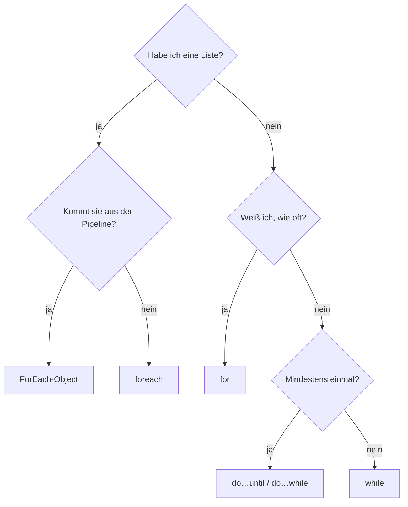

# 06 PowerShell – Schleifen
← [[05_PS-Bedingungen]] · → [[07_PS-Funktionen-Parameter]]

**Inhalt:** [[#1 Idee]] · [[#2 foreach]] · [[#3 ForEach-Object]] · [[#4 for]] · [[#5 while und do]] · [[#6 break und continue]] · [[#7 Welche Schleife wann]] · [[#8 Praxisbeispiel]] · [[#9 Kontrollfragen]]

---

## 1 Idee

> [!example] Für Kinder erklärt
> Eine [[Schleife]] ist wie **Zähneputzen**: „Putze jeden Zahn“ – du musst nicht 28-mal aufschreiben „Putze Zahn 1, putze Zahn 2 …“. Du sagst einmal **was** zu tun ist, und der Roboter macht es **für jeden Zahn**. Oder: „Rühre, **solange** der Teig klumpt.“

| Art | Frage | Beispiel aus dem Alltag |
|---|---|---|
| `foreach` | Was mache ich mit **jedem** Ding? | jeden Zahn putzen |
| `for` | Wie oft genau? | 10 Liegestütze |
| `while` | Wie lange noch? | rühren, solange es klumpt |
| `do…until` | Mindestens einmal, dann prüfen | probieren, bis es schmeckt |

---

## 2 foreach
```powershell
# Maschine: Hyper-V-Host
$server = 'EXA-DC01', 'EXA-SRV01', 'EXA-SRV02'

foreach ($s in $server) {
    $online = Test-Connection -ComputerName $s -Count 1 -Quiet
    "{0,-10} {1}" -f $s, $(if ($online) {'online'} else {'OFFLINE'})
}
```
Lies: „**Für jedes** `$s` **in** `$server` mache …“

---

## 3 ForEach-Object
Pipeline-Variante: verarbeitet Objekte, **während** sie ankommen (spart Speicher bei großen Mengen).
```powershell
# Maschine: Schul-PC
Get-ChildItem C:\Temp -File | ForEach-Object {
    "{0} – {1:N0} KB" -f $_.Name, ($_.Length / 1KB)
}
```

| | `foreach (…) { }` | `… \| ForEach-Object { }` |
|---|---|---|
| Daten | alle zuerst im Speicher | Stück für Stück |
| Tempo | schneller | etwas langsamer |
| Variable | eigener Name (`$s`) | `$_` |
| Einsatz | Skripte, Listen | Pipeline, große Datenmengen |

PowerShell 7: `ForEach-Object -Parallel { } -ThrottleLimit 5` für parallele Ausführung.

---

## 4 for
Zähl-Schleife: **Start; Bedingung; Schritt**.
```powershell
# Maschine: Schul-PC
for ($i = 1; $i -le 5; $i++) {
    "Testbenutzer$i"
}
```
```text
$i = 1        → Start
$i -le 5      → läuft, solange wahr
$i++          → nach jeder Runde +1
```

---

## 5 while und do

```powershell
# Maschine: EXA-SRV01 – warten, bis der Webdienst läuft (max. 30 s)
$sekunden = 0
while ((Get-Service W3SVC).Status -ne 'Running' -and $sekunden -lt 30) {
    Start-Sleep -Seconds 2
    $sekunden += 2
}
```

```powershell
# Maschine: Schul-PC – mindestens einmal fragen
do {
    $antwort = Read-Host 'Fortfahren? (j/n)'
} until ($antwort -in 'j', 'n')
```

> [!danger] Endlosschleife
> Wird die Bedingung nie falsch, läuft die Schleife ewig. Immer eine **Notbremse** einbauen (Zähler, Zeitlimit). Abbruch in der Konsole: `Strg + C`.

---

## 6 break und continue

| Befehl | Wirkung |
|---|---|
| `continue` | diese Runde überspringen, mit der nächsten weitermachen |
| `break` | Schleife sofort ganz beenden |

```powershell
# Maschine: Schul-PC
foreach ($zahl in 1..10) {
    if ($zahl % 2 -eq 0) { continue }   # gerade Zahlen überspringen
    if ($zahl -gt 7)     { break }      # ab 8 aufhören
    $zahl                               # 1 3 5 7
}
```

---

## 7 Welche Schleife wann



---

## 8 Praxisbeispiel
Speicherplatz aller Server prüfen:
```powershell
# Maschine: Hyper-V-Host (Remoting aktiv, siehe Kapitel 11)
$server = 'EXA-DC01', 'EXA-SRV01', 'EXA-SRV02'
$bericht = foreach ($s in $server) {
    try {
        $disks = Get-CimInstance Win32_LogicalDisk -ComputerName $s -Filter 'DriveType=3' -ErrorAction Stop
        foreach ($d in $disks) {
            [pscustomobject]@{
                Server  = $s
                LW      = $d.DeviceID
                FreiGB  = [math]::Round($d.FreeSpace / 1GB, 1)
                FreiPct = [math]::Round($d.FreeSpace / $d.Size * 100)
            }
        }
    } catch {
        Write-Warning "$s nicht erreichbar: $($_.Exception.Message)"
    }
}
$bericht | Sort-Object FreiPct | Format-Table -AutoSize
```
Tipp: Ergebnis einer Schleife direkt einer Variable zuweisen (`$bericht = foreach …`) statt `+=` – schneller und sauberer.

---

## 9 Kontrollfragen
1. Gib mit einer `for`-Schleife die Zahlen 10, 8, 6, 4, 2 aus.
2. Unterschied zwischen `while` und `do…until`?
3. Wozu dient `continue`?

> [!success]- Lösungen
> 1. `for ($i = 10; $i -ge 2; $i -= 2) { $i }`
> 2. `while` prüft **vorher** (läuft evtl. nie), `do…until` prüft **nachher** (läuft mindestens einmal).
> 3. Aktuelle Runde überspringen, Schleife läuft weiter.
