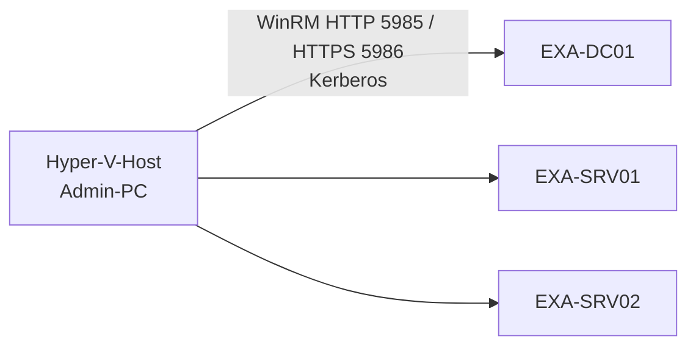

# 11 PowerShell – Remoting
← [[10_PS-Skripte-Module-Sicherheit]] · → [[12_PS-Praxis-Lab]]

**Inhalt:** [[#1 Idee]] · [[#2 Voraussetzungen]] · [[#3 Interaktiv Enter-PSSession]] · [[#4 Befehle auf vielen Servern Invoke-Command]] · [[#5 Dauerhafte Sitzungen]] · [[#6 Lokale Variablen übergeben]] · [[#7 Ohne Domäne (Arbeitsgruppe)]] · [[#8 Fehlersuche]] · [[#9 Kontrollfragen]]

---

## 1 Idee

> [!example] Für Kinder erklärt
> [[PS-Remoting]] ist wie eine **Fernbedienung**: Du sitzt auf dem Sofa (Hyper-V-Host) und schaltest den Fernseher (EXA-DC01) um, ohne aufzustehen. Mit `Invoke-Command` hast du sogar eine Fernbedienung für **alle Fernseher im Haus gleichzeitig**.



---

## 2 Voraussetzungen

| Punkt | Detail |
|---|---|
| Dienst | [[WinRM]] läuft (Windows Server: Standard aktiv) |
| Ports | 5985 (HTTP, Inhalt trotzdem per Kerberos verschlüsselt), 5986 (HTTPS) |
| Rechte | Mitglied der lokalen Administratoren oder „Remote Management Users“ |
| Domäne | Kerberos-Anmeldung über Computernamen (nicht IP) |

```powershell
# Maschine: EXA-SRV01 (falls deaktiviert)
Enable-PSRemoting -Force

# Maschine: Hyper-V-Host – Verbindung prüfen
Test-WSMan EXA-SRV01
Test-NetConnection EXA-SRV01 -Port 5985
```
Im Unternehmen per **GPO** aktivieren: *Computerkonfiguration → Richtlinien → Administrative Vorlagen → Windows-Komponenten → Windows-Remoteverwaltung*.

---

## 3 Interaktiv Enter-PSSession
Eine Sitzung auf **einem** Server – wie RDP, nur Text.
```powershell
# Maschine: Hyper-V-Host
Enter-PSSession -ComputerName EXA-DC01 -Credential EXAMPLE\Administrator
# Prompt wird zu: [EXA-DC01]: PS C:\Users\Administrator\Documents>
Get-ADDomain | Select-Object DNSRoot, PDCEmulator
Exit-PSSession
```

---

## 4 Befehle auf vielen Servern Invoke-Command
Läuft **parallel** auf allen Zielen (Standard bis 32 gleichzeitig).
```powershell
# Maschine: Hyper-V-Host
$server = 'EXA-DC01', 'EXA-SRV01', 'EXA-SRV02'
$cred   = Get-Credential EXAMPLE\Administrator

Invoke-Command -ComputerName $server -Credential $cred -ScriptBlock {
    [pscustomobject]@{
        OS       = (Get-CimInstance Win32_OperatingSystem).Caption
        Uptime_h = [math]::Round(((Get-Date) - (Get-CimInstance Win32_OperatingSystem).LastBootUpTime).TotalHours, 1)
        Updates  = (Get-HotFix | Measure-Object).Count
    }
} | Select-Object PSComputerName, OS, Uptime_h, Updates | Format-Table -AutoSize
```
`PSComputerName` wird automatisch ergänzt → du siehst, welcher Server geantwortet hat.

Ein ganzes Skript remote ausführen:
```powershell
Invoke-Command -ComputerName $server -FilePath C:\Skripte\Systembericht.ps1
```

---

## 5 Dauerhafte Sitzungen
Eine [[PSSession]] bleibt offen → schneller bei mehreren Befehlen, Variablen bleiben erhalten.
```powershell
# Maschine: Hyper-V-Host
$s = New-PSSession -ComputerName EXA-DC01 -Credential $cred
Invoke-Command -Session $s -ScriptBlock { $zaehler = 1 }
Invoke-Command -Session $s -ScriptBlock { $zaehler + 1 }     # 2 – Variable noch da
Copy-Item C:\Skripte\benutzer.csv -Destination C:\Skripte\ -ToSession $s
Remove-PSSession $s
```

---

## 6 Lokale Variablen übergeben
Der [[Scriptblock]] läuft auf dem **anderen** Computer – deine lokalen Variablen kennt er nicht.
```powershell
# Maschine: Hyper-V-Host
$dienst = 'W3SVC'
Invoke-Command -ComputerName EXA-SRV01 -ScriptBlock { Get-Service $dienst }         # FALSCH: $dienst leer
Invoke-Command -ComputerName EXA-SRV01 -ScriptBlock { Get-Service $using:dienst }   # richtig
```

> [!example] Für Kinder erklärt
> Schickst du deinem Freund einen Zettel „Bring mir **das**“, weiß er nicht, was „das“ ist – er sieht ja nicht, worauf du zeigst. Mit `$using:` schreibst du den Gegenstand **auf den Zettel** dazu.

---

## 7 Ohne Domäne (Arbeitsgruppe)
Kerberos fehlt → Ziel muss als vertrauenswürdig eingetragen werden (oder HTTPS nutzen).
```powershell
# Maschine: Schul-PC (Admin) – nur im Lab!
Set-Item WSMan:\localhost\Client\TrustedHosts -Value '192.168.10.50' -Concatenate -Force
Enter-PSSession -ComputerName 192.168.10.50 -Credential (Get-Credential)
```
> [!warning] Sicherheit
> `TrustedHosts = *` schaltet die Prüfung der Gegenstelle ab. Produktiv: Domäne/Kerberos oder HTTPS (5986) mit Zertifikat der CA.

PowerShell 7 kann zusätzlich über **SSH** verbinden (auch zu Linux, z. B. EXA-DOCKER01): `Enter-PSSession -HostName EXA-DOCKER01 -UserName admin`.

---

## 8 Fehlersuche

| Meldung | Ursache | Lösung |
|---|---|---|
| `WinRM cannot complete the operation` | Dienst aus / Firewall | `Enable-PSRemoting`, Port 5985 |
| `Access is denied` | keine Rechte | Gruppe Administratoren / Remote Management Users |
| `The WinRM client cannot process the request … TrustedHosts` | IP statt Name / keine Domäne | Namen verwenden oder TrustedHosts |
| Variable im Scriptblock leer | lokaler Bereich | `$using:` |
| Second Hop: Zugriff vom Ziel auf Freigabe scheitert | Anmeldedaten werden nicht weitergereicht | Daten vorher kopieren, CredSSP vermeiden, ressourcenbasierte Delegierung |

---

## 9 Kontrollfragen
1. Unterschied `Enter-PSSession` und `Invoke-Command`?
2. Welche Ports nutzt WinRM?
3. Warum braucht man `$using:`?

> [!success]- Lösungen
> 1. `Enter-PSSession`: interaktiv, ein Server. `Invoke-Command`: Befehl/Skript auf vielen Servern parallel, Ergebnisse zurück.
> 2. 5985 (HTTP), 5986 (HTTPS).
> 3. Der Scriptblock läuft remote und kennt lokale Variablen nicht.
