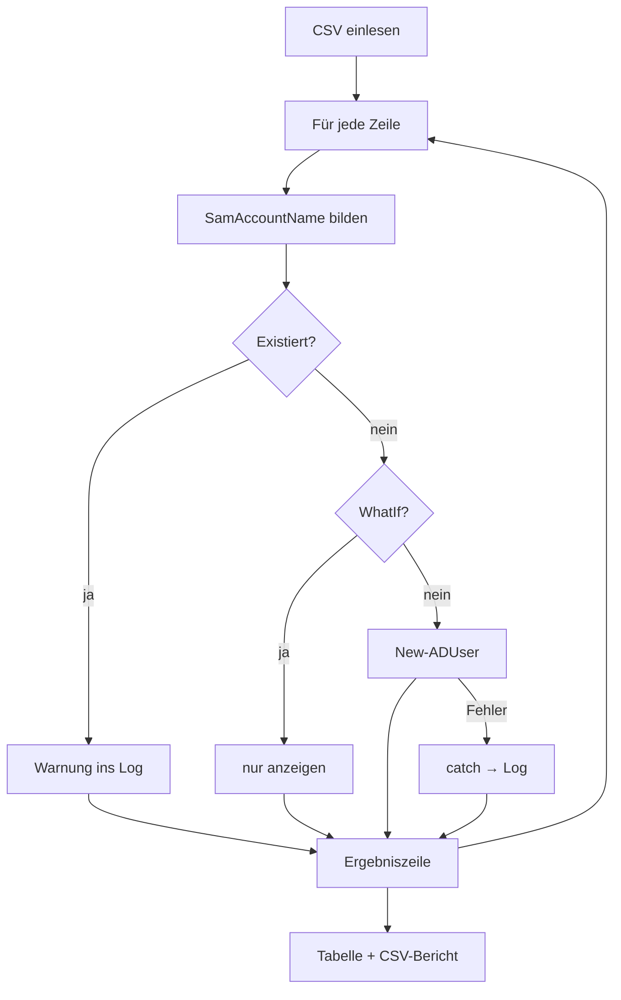

# 12 PowerShell – Praxis-Lab
← [[11_PS-Remoting]] · → [[13_PS-Stil-Best-Practices]]

> [!info] Ziel
> Drei echte Admin-Skripte für EXAMPLE.COM: **Benutzer aus CSV anlegen**, **Systembericht als HTML**, **automatischer Test** der eigenen Funktion. Alles mit Parametern, Fehlerbehandlung, Log und `-WhatIf`.

**Inhalt:** [[#Projektordner]] · [[#Projekt A Benutzer aus CSV]] · [[#Projekt B Systembericht]] · [[#Projekt C Automatische Tests mit Pester]] · [[#PowerShell-Validierung]] · [[#Checkliste]]

---

## Projektordner
```text
C:\Skripte\                      (EXA-DC01)
├── LabFunktionen.ps1            gemeinsame Funktionen
├── New-LabBenutzer.ps1          Projekt A
├── Systembericht.ps1            Projekt B
├── Tests\
│   └── LabFunktionen.Tests.ps1  Projekt C
├── daten\
│   └── neue_benutzer.csv
└── log\
```
```powershell
# Maschine: EXA-DC01
New-Item C:\Skripte\Tests, C:\Skripte\daten, C:\Skripte\log -ItemType Directory -Force | Out-Null
```

---

## Projekt A Benutzer aus CSV

> [!example] Für Kinder erklärt
> Stell dir vor, 30 neue Kinder kommen in die Schule und jedes braucht einen Spind mit Namensschild. Statt 30-mal dasselbe zu machen, gibst du dem Roboter die **Klassenliste**. Er nimmt **jede Zeile** (Schleife), prüft, ob es den Spind schon gibt (Bedingung), und klebt sonst ein neues Schild drauf.

`C:\Skripte\daten\neue_benutzer.csv` (UTF-8, Semikolon)
```csv
Vorname;Nachname;Abteilung
Anna;Schmidt;IT
Jörg;Müller;Vertrieb
Ömer;Yıldız;IT
Lisa-Marie;Groß;Buchhaltung
```

`C:\Skripte\LabFunktionen.ps1`
```powershell
function ConvertTo-SamName {
<#
.SYNOPSIS
    Erzeugt einen SamAccountName vorname.nachname ohne Umlaute, max. 20 Zeichen.
.EXAMPLE
    ConvertTo-SamName -Vorname 'Jörg' -Nachname 'Müller'   # joerg.mueller
#>
    [CmdletBinding()]
    param(
        [Parameter(Mandatory)][string]$Vorname,
        [Parameter(Mandatory)][string]$Nachname
    )
    $name = ('{0}.{1}' -f $Vorname, $Nachname).ToLower()
    $ersetzen = [ordered]@{ 'ä'='ae'; 'ö'='oe'; 'ü'='ue'; 'ß'='ss'; 'ı'='i' }
    foreach ($k in $ersetzen.Keys) { $name = $name.Replace($k, $ersetzen[$k]) }
    $name = $name -replace '[^a-z0-9\.\-]', ''          # alles andere entfernen
    if ($name.Length -gt 20) { $name = $name.Substring(0, 20) }
    $name.TrimEnd('.', '-')
}

function Write-Log {
    param(
        [Parameter(Mandatory)][string]$Text,
        [ValidateSet('INFO','WARN','FEHLER')][string]$Stufe = 'INFO',
        [Parameter(Mandatory)][string]$Datei
    )
    $zeile = '{0:yyyy-MM-dd HH:mm:ss} [{1}] {2}' -f (Get-Date), $Stufe, $Text
    Add-Content -Path $Datei -Value $zeile -Encoding UTF8
    switch ($Stufe) {
        'WARN'   { Write-Warning $Text }
        'FEHLER' { Write-Host $Text -ForegroundColor Red }
        default  { Write-Verbose $Text }
    }
}
```

`C:\Skripte\New-LabBenutzer.ps1`
```powershell
<#
.SYNOPSIS
    Legt AD-Benutzer aus einer CSV-Datei an.
.PARAMETER CsvPfad
    CSV mit Spalten Vorname;Nachname;Abteilung (UTF-8).
.PARAMETER OU
    Ziel-OU (Distinguished Name).
.EXAMPLE
    .\New-LabBenutzer.ps1 -WhatIf -Verbose
.NOTES
    Maschine: EXA-DC01 · Modul ActiveDirectory
#>
#Requires -Modules ActiveDirectory
[CmdletBinding(SupportsShouldProcess)]
param(
    [ValidateScript({ Test-Path $_ })]
    [string]$CsvPfad = "$PSScriptRoot\daten\neue_benutzer.csv",
    [string]$OU      = 'OU=Benutzer,DC=example,DC=com',
    [string]$Domaene = 'example.com'
)

$ErrorActionPreference = 'Stop'
. "$PSScriptRoot\LabFunktionen.ps1"                              # Funktionen laden (Dot-Sourcing)
$log = Join-Path $PSScriptRoot ("log\benutzer_{0:yyyyMMdd_HHmm}.log" -f (Get-Date))

# 1 Eingabe prüfen
try { Get-ADOrganizationalUnit -Identity $OU | Out-Null }
catch { Write-Log "OU nicht gefunden: $OU" -Stufe FEHLER -Datei $log; exit 1 }

$benutzer = Import-Csv $CsvPfad -Delimiter ';' -Encoding UTF8
$startPw  = Read-Host 'Startpasswort für alle neuen Konten' -AsSecureString
Write-Log "Start: $($benutzer.Count) Zeilen aus $CsvPfad" -Datei $log

# 2 Verarbeitung
$ergebnis = foreach ($b in $benutzer) {
    $sam    = ConvertTo-SamName -Vorname $b.Vorname -Nachname $b.Nachname
    $status = ''
    try {
        if (Get-ADUser -Filter "SamAccountName -eq '$sam'") {
            $status = 'existiert bereits'
            Write-Log "$sam existiert bereits – übersprungen" -Stufe WARN -Datei $log
        }
        elseif ($PSCmdlet.ShouldProcess($sam, 'AD-Benutzer anlegen')) {
            $param = @{
                Name                  = "$($b.Vorname) $($b.Nachname)"
                GivenName             = $b.Vorname
                Surname               = $b.Nachname
                SamAccountName        = $sam
                UserPrincipalName     = "$sam@$Domaene"
                Department            = $b.Abteilung
                Path                  = $OU
                AccountPassword       = $startPw
                ChangePasswordAtLogon = $true
                Enabled               = $true
            }
            New-ADUser @param
            $status = 'angelegt'
            Write-Log "$sam angelegt" -Datei $log
        }
        else { $status = 'WhatIf' }
    }
    catch {
        $status = "Fehler: $($_.Exception.Message)"
        Write-Log "$sam – $status" -Stufe FEHLER -Datei $log
    }
    [pscustomobject]@{ Name = "$($b.Vorname) $($b.Nachname)"; SamAccountName = $sam; Status = $status }
}

# 3 Ausgabe
$ergebnis | Format-Table -AutoSize
$ergebnis | Export-Csv ($log -replace '\.log$', '.csv') -NoTypeInformation -Delimiter ';' -Encoding UTF8
Write-Log 'Ende' -Datei $log
```

Ablauf:
```powershell
# Maschine: EXA-DC01
New-ADOrganizationalUnit -Name Benutzer -Path 'DC=example,DC=com'   # falls noch nicht vorhanden
Set-Location C:\Skripte
.\New-LabBenutzer.ps1 -WhatIf -Verbose     # 1. Trockenlauf
.\New-LabBenutzer.ps1                      # 2. echt
.\New-LabBenutzer.ps1                      # 3. erneut: alle "existiert bereits"
```



---

## Projekt B Systembericht
`C:\Skripte\Systembericht.ps1` – läuft lokal oder per Remoting auf mehreren Servern, erzeugt HTML.
```powershell
<#
.SYNOPSIS
    HTML-Bericht über Betriebssystem, Laufzeit, Speicher und gestoppte Autostart-Dienste.
.EXAMPLE
    .\Systembericht.ps1 -ComputerName EXA-DC01, EXA-SRV01 -Ziel C:\Skripte\bericht.html
#>
[CmdletBinding()]
param(
    [string[]]$ComputerName = $env:COMPUTERNAME,
    [string]$Ziel = "$PSScriptRoot\Systembericht_$(Get-Date -Format yyyyMMdd).html",
    [ValidateRange(1,100)][int]$WarnProzent = 15
)

$sammeln = {
    $os    = Get-CimInstance Win32_OperatingSystem
    $disks = Get-CimInstance Win32_LogicalDisk -Filter 'DriveType=3'
    $dienste = Get-CimInstance Win32_Service -Filter "StartMode='Auto' AND State<>'Running'"
    [pscustomobject]@{
        Server       = $env:COMPUTERNAME
        OS           = $os.Caption
        Uptime_Tage  = [math]::Round(((Get-Date) - $os.LastBootUpTime).TotalDays, 1)
        RAM_frei_Pct = [math]::Round($os.FreePhysicalMemory / $os.TotalVisibleMemorySize * 100)
        Platte_min_Pct = ($disks | ForEach-Object { [math]::Round($_.FreeSpace / $_.Size * 100) } | Measure-Object -Minimum).Minimum
        Dienste_gestoppt = ($dienste.Name -join ', ')
    }
}

$daten = foreach ($c in $ComputerName) {
    try {
        if ($c -eq $env:COMPUTERNAME) { & $sammeln }
        else { Invoke-Command -ComputerName $c -ScriptBlock $sammeln -ErrorAction Stop |
               Select-Object * -ExcludeProperty PSComputerName, RunspaceId, PSShowComputerName }
    } catch {
        [pscustomobject]@{ Server = $c; OS = "NICHT ERREICHBAR: $($_.Exception.Message)" }
    }
}

$stil = '<style>body{font-family:Segoe UI;}table{border-collapse:collapse}td,th{border:1px solid #ccc;padding:4px 8px}th{background:#1f4e79;color:#fff}.warn{background:#f8d7da}</style>'
$html = $daten | ConvertTo-Html -Title 'Systembericht EXAMPLE' -PreContent "<h1>Systembericht $(Get-Date -Format 'dd.MM.yyyy HH:mm')</h1>" -Head $stil
# Zeilen mit wenig Plattenplatz markieren
$html = $html | ForEach-Object {
    if ($_ -match '<td>(\d+)</td><td>[^<]*</td></tr>$' -and [int]$Matches[1] -lt $WarnProzent) { $_ -replace '<tr>', '<tr class="warn">' } else { $_ }
}
$html | Set-Content $Ziel -Encoding UTF8
Write-Host "Bericht: $Ziel" -ForegroundColor Green
$daten | Format-Table -AutoSize
```
```powershell
# Maschine: EXA-DC01
.\Systembericht.ps1 -ComputerName EXA-DC01, EXA-SRV01, EXA-SRV02
Invoke-Item .\Systembericht_*.html
```
Automatisch täglich → [[10_PS-Skripte-Module-Sicherheit#8 Automatisch ausführen (Aufgabenplanung)]].

---

## Projekt C Automatische Tests mit Pester
[[Pester]] prüft, ob Funktionen das Richtige liefern – nach **jeder** Änderung in Sekunden.

> [!example] Für Kinder erklärt
> Ein Test ist wie eine **Probe beim Kuchenbacken**: „Wenn ich Zucker reinmache, muss es süß schmecken.“ Pester probiert deine Funktion mit festen Zutaten und sagt **grün** (stimmt) oder **rot** (stimmt nicht).

```powershell
# Maschine: EXA-DC01 (einmalig, braucht Internet; sonst auf Schul-PC testen)
Install-Module Pester -Force -SkipPublisherCheck -Scope CurrentUser
```

`C:\Skripte\Tests\LabFunktionen.Tests.ps1` (Pester 5)
```powershell
BeforeAll {
    . "$PSScriptRoot\..\LabFunktionen.ps1"
}

Describe 'ConvertTo-SamName' {
    It 'bildet vorname.nachname in Kleinbuchstaben' {
        ConvertTo-SamName -Vorname 'Anna' -Nachname 'Schmidt' | Should -Be 'anna.schmidt'
    }
    It 'ersetzt Umlaute und ß' {
        ConvertTo-SamName -Vorname 'Jörg' -Nachname 'Groß' | Should -Be 'joerg.gross'
    }
    It 'entfernt Sonderzeichen' {
        ConvertTo-SamName -Vorname "D'Angelo" -Nachname 'Ruiz' | Should -Be 'dangelo.ruiz'
    }
    It 'ist höchstens 20 Zeichen lang' {
        (ConvertTo-SamName -Vorname 'Maximilian' -Nachname 'Mustermann-Schulze').Length | Should -BeLessOrEqual 20
    }
}
```
```powershell
# Maschine: EXA-DC01
Invoke-Pester -Path C:\Skripte\Tests -Output Detailed
```
Später automatisch bei jedem Git-Push → [[CI-CD]].

---

## PowerShell-Validierung
```powershell
# Maschine: EXA-DC01 – prüft das Ergebnis von Projekt A und B
$checks = [ordered]@{
  'OU Benutzer vorhanden'   = [bool](Get-ADOrganizationalUnit -Filter "Name -eq 'Benutzer'")
  'joerg.mueller angelegt'  = [bool](Get-ADUser -Filter "SamAccountName -eq 'joerg.mueller'")
  'Passwort muss geändert'  = (Get-ADUser joerg.mueller -Properties pwdLastSet).pwdLastSet -eq 0
  'Abteilung gesetzt'       = (Get-ADUser joerg.mueller -Properties Department).Department -eq 'Vertrieb'
  'Log vorhanden'           = [bool](Get-ChildItem C:\Skripte\log\benutzer_*.log -ErrorAction SilentlyContinue)
  'HTML-Bericht vorhanden'  = [bool](Get-ChildItem C:\Skripte\Systembericht_*.html -ErrorAction SilentlyContinue)
}
$checks.GetEnumerator() | ForEach-Object { '{0,-24} {1}' -f $_.Key, $(if ($_.Value) {'OK'} else {'FEHLER'}) }
```

Aufräumen:
```powershell
# Maschine: EXA-DC01
Get-ADUser -Filter * -SearchBase 'OU=Benutzer,DC=example,DC=com' | Remove-ADUser -WhatIf
```

---

## Checkliste
- [ ] `LabFunktionen.ps1` mit `ConvertTo-SamName` und `Write-Log`
- [ ] `New-LabBenutzer.ps1 -WhatIf` zeigt 4 Konten
- [ ] Echter Lauf legt 4 Konten an, zweiter Lauf meldet „existiert bereits“
- [ ] Log und CSV-Ergebnis in `C:\Skripte\log`
- [ ] `Systembericht.ps1` erzeugt HTML für 3 Server
- [ ] Pester: 4 Tests grün
- [ ] Validierung komplett OK
- [ ] Skripte in Git (Vault oder eigenes Repo)
