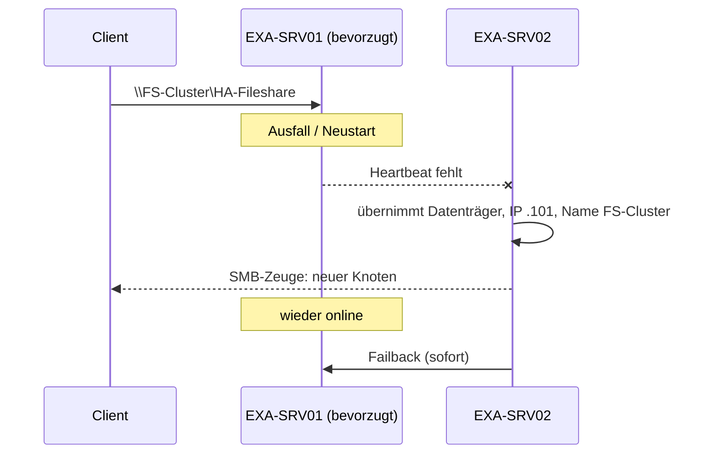

# Hochverfügbarer Dateiserver (Failovercluster)

Thema: [[Cluster und Failover]] · Grundlagen: [[Failovercluster]] · Praxis: [[Lab Failovercluster Dateiserver]] · Glossar: [[SMB]] · [[SoFS]] · [[Fortlaufende Verfügbarkeit]]
Unterlagen: [[Failovercluster_12_Fragen.pdf|Fragen]] · [[Failovercluster_12_Fragen_Loesung.pdf|Lösungen]] · [[Uebung_Failovercluster_Loesung.pdf#page=5|Übung Schritt 8–11]]

> [!summary] Kernidee
> - Ziel: Freigaben bleiben erreichbar, auch wenn ein Server ausfällt oder gewartet wird.
> - Clients verbinden sich mit dem **Clientzugriffspunkt** (`\\FS-Cluster\…`), nie mit einem Knotennamen.
> - **Fortlaufende Verfügbarkeit** hält offene Dateien beim Knotenwechsel offen.

## 1. Zwei Rollentypen
| | Dateiserver zur allgemeinen Verwendung | Dateiserver mit horizontaler Skalierung ([[SoFS]]) |
|---|---|---|
| Betrieb | Aktiv/Passiv – Rolle läuft auf **einem** Knoten | Aktiv/Aktiv – Freigabe auf **allen** Knoten online |
| Speicher | klassischer Clusterdatenträger (NTFS) | **[[CSV]] Pflicht** |
| Für | Benutzer- und Abteilungsdaten, Basisordner, Gruppenlaufwerke | Anwendungsdaten: Hyper-V-VHDX, SQL-Datenbanken |
| FSRM, DFS-Replikation, BranchCache | ja | nein |
| Deduplizierung | ja | nur VDI |
| Viele kleine Dateioperationen | gut | ungeeignet (Metadaten-Last) |

In der Übung: **allgemeine Verwendung** (FS-Cluster, Clusterdatenträger 2).
Fragen: [[Failovercluster_12_Fragen.pdf#page=1|A2, A3]] · Lösung: [[Failovercluster_12_Fragen_Loesung.pdf#page=1|A2, A3]] · Ergänzung: [[Failovercluster_12_Fragen_Loesung.pdf#page=4|Feature-Tabelle]]

### Voraussetzungen auf jedem Knoten
```powershell
# Maschine: EXA-DC01 – installiert auf allen Knoten
Invoke-Command -ComputerName EXA-SRV01,EXA-SRV02,EXA-SRV04 -ScriptBlock {
  Install-WindowsFeature Failover-Clustering, FS-FileServer -IncludeManagementTools }
```

## 2. Fortlaufende Verfügbarkeit (Continuous Availability)
| Technik | Aufgabe |
|---|---|
| Persistente Handles | offene Dateien werden beim Failover nicht verworfen |
| [[SMB-Zeuge]] (SMB Witness) | informiert Clients aktiv über den neuen Besitzerknoten |
| Transparent Failover (SMB 3.x) | Client verbindet sich neu, die Anwendung merkt höchstens kurze Verzögerung |

- PowerShell: `New-SmbShare … -ContinuouslyAvailable $true`. Bei Clusterfreigaben ist es standardmäßig an.
- ⚠ Nicht kombinierbar mit FSRM-Kontingenten und Dateiprüfungen.

Fragen: [[Failovercluster_12_Fragen.pdf#page=2|A6]] · Lösung: [[Failovercluster_12_Fragen_Loesung.pdf#page=2|A6]]

## 3. Optionen der Freigabe (Übung Schritt 9)
| Option im Assistenten | PowerShell | Wirkung |
|---|---|---|
| Zugriffsbasierte Aufzählung | `-FolderEnumerationMode AccessBased` | Benutzer sehen nur, worauf sie Rechte haben ([[ABE]]) |
| Fortlaufende Verfügbarkeit | `-ContinuouslyAvailable $true` | siehe Abschnitt 2 |
| Zwischenspeicherung zulassen | `-CachingMode Manual` | Offlinedateien auf dem Client erlaubt |
| Clusterbezug | `-ScopeName FS-Cluster` | Freigabe hängt am Clientzugriffspunkt, nicht am Knoten |

**Standardberechtigungen (Assistent „Schnell“):** Freigabe *Jeder – Vollzugriff* · NTFS vom Volume geerbt. Wirksam ist immer die **strengere** Kombination aus Freigabe- und [[NTFS]]-Recht.

## 4. Bevorzugte Besitzer, Failover, Failback (Übung Schritt 10–11)
| Einstellung | Wo | Wert in der Übung | PowerShell |
|---|---|---|---|
| [[Bevorzugter Besitzer]] | Eigenschaften → Allgemein | SRV01 → SRV02 → SRV04 | `Set-ClusterOwnerNode -Group FS-Cluster -Owners …` |
| [[Failback]] zulassen | Eigenschaften → **Failover** → Failback | zulassen | `AutoFailbackType = 1` |
| Zeitfenster | ebenda | sofort | `FailbackWindowStart/End = -1` |
| Manuell verschieben | Aktionen → Verschieben | EXA-SRV01 | `Move-ClusterGroup FS-Cluster -Node EXA-SRV01` |



> [!info] Geordnet vs. ungeplant
> `Restart-Computer` fährt den Clusterdienst sauber herunter – die Rolle wird kontrolliert abgegeben. Einen echten Absturz bildet im Hyper-V-Lab `Stop-VM -TurnOff` nach.

## 5. Befehle zum Prüfen
```powershell
# Maschine: EXA-DC01
Get-ClusterGroup -Cluster myCluster -Name FS-Cluster |
  Format-List Name, OwnerNode, State, AutoFailbackType, FailbackWindowStart, FailbackWindowEnd
Get-ClusterOwnerNode -Cluster myCluster -Group FS-Cluster
Get-SmbShare -CimSession EXA-SRV01 -ScopeName FS-Cluster |
  Format-Table Name, ContinuouslyAvailable, FolderEnumerationMode, CachingMode
Get-SmbWitnessClient -CimSession EXA-SRV01   # Clients, die vom SMB-Zeugen informiert werden
```

## Quellen
- [Scale-Out File Server overview – Microsoft Learn](https://learn.microsoft.com/en-us/windows-server/failover-clustering/sofs-overview)
- [Add-ClusterFileServerRole – Microsoft Learn](https://learn.microsoft.com/en-us/powershell/module/failoverclusters/add-clusterfileserverrole)
- [Groups.FailbackWindowStart – Microsoft Learn](https://learn.microsoft.com/en-us/previous-versions/windows/desktop/mscs/groups-failbackwindowstart)
