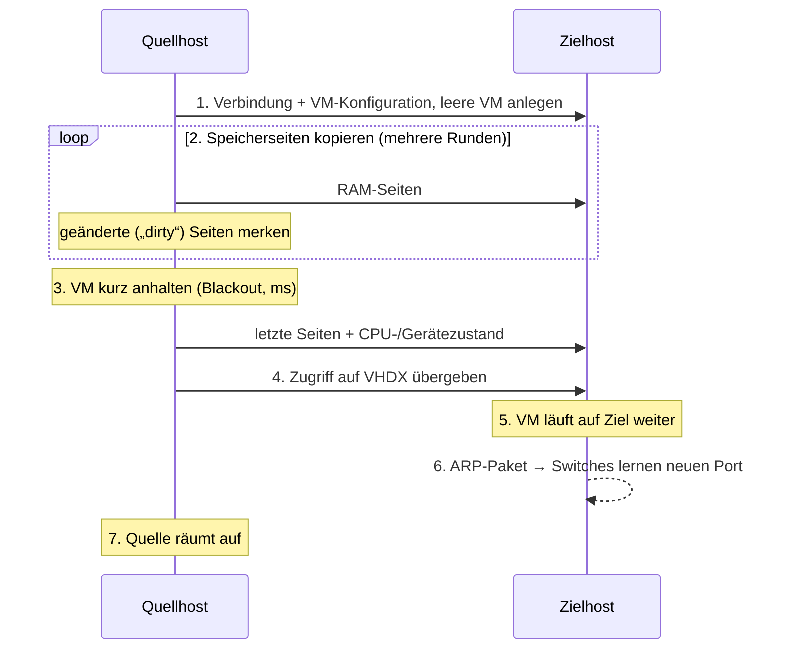

# Livemigration (Hyper-V)

Thema: [[Cluster und Failover]] · [[Windows Server]] · Prüfung: [[AZ-802 3 Virtuelle Maschinen]] · Verwandt: [[Failovercluster]] · [[HyperV-VM-Export-Import]] · [[Hochverfügbarer Dateiserver]] (SoFS für VM-Speicher)
Glossar: [[Livemigration]] · [[Shared-Nothing-Livemigration]] · [[Speichermigration]] · [[Schnellmigration]] · [[CredSSP]] · [[Eingeschränkte Delegierung]] · [[Credential Guard]] · [[Migrationsnetzwerk]] · [[SMB Direct]] · [[RDMA]] · [[SMB Multichannel]] · [[Prozessorkompatibilität]] · [[VMMS]] · [[Hyper-V]]
Buch 70-740: [[70-740_Server2016_Installation_Speicher.pdf#page=358|Livemigration]] · [[70-740_Server2016_Installation_Speicher.pdf#page=361|Einstellungen]] · [[70-740_Server2016_Installation_Speicher.pdf#page=363|Shared Nothing]] · [[70-740_Server2016_Installation_Speicher.pdf#page=364|CredSSP/Kerberos]] · [[70-740_Server2016_Installation_Speicher.pdf#page=365|Delegierung]] · [[70-740_Server2016_Installation_Speicher.pdf#page=366|Speichermigration]] · [[70-740_Server2016_Installation_Speicher.pdf#page=434|im Cluster]] · [[70-740_Server2016_Installation_Speicher.pdf#page=435|Schnellmigration]]

> [!summary] Kernidee
> - Eine **laufende** VM zieht von einem Hyper-V-Host auf einen anderen um, **ohne spürbare Unterbrechung** (Pause im Millisekundenbereich).
> - Übertragen werden **Arbeitsspeicher und Zustand**; die Festplatten bleiben auf gemeinsamem Speicher – oder ziehen bei *Shared Nothing* mit.
> - Einsatz: Host warten/patchen ohne Ausfall ([[CAU]]), Last verteilen, Hardware tauschen. **Kein Schutz** gegen Absturz → dafür Failover/Replikat.

## 1. Arten im Vergleich
| Art | Was wandert? | VM-Zustand | Unterbrechung | Voraussetzung |
|---|---|---|---|---|
| **Livemigration im Cluster** | RAM + Zustand | läuft | ~0 (ms) | Failovercluster, VM auf [[CSV]] oder SMB-Freigabe ([[SoFS]]) |
| **Livemigration ohne Cluster** (ab 2012) | RAM + Zustand | läuft | ~0 | VM-Dateien auf SMB-Freigabe, beide Hosts dürfen zugreifen |
| **[[Shared-Nothing-Livemigration]]** | RAM + Zustand **+ alle Dateien** | läuft | ~0, dauert aber länger | nur Netzwerk zwischen den Hosts, kein gemeinsamer Speicher |
| **[[Speichermigration]]** | nur Dateien (VHDX, Config, Checkpoints) | läuft, bleibt auf **demselben** Host | keine | – |
| **[[Schnellmigration]]** (Quick Migration) | Zustand über gespeicherten Status | wird kurz gespeichert | spürbar (Sekunden) | Cluster; auch für angehaltene VMs |
| Export/Import | alles als Kopie | **aus** | lang | keine Verbindung nötig → [[HyperV-VM-Export-Import]] |
| Hyper-V-Replikat | Kopie läuft asynchron mit | Ziel-VM aus | Notfall-Umschaltung | Disaster Recovery, keine Migration |

## 2. Ablauf einer Livemigration

Je mehr RAM die VM während der Migration ändert, desto mehr Runden sind nötig → schnelles Netz wichtig.

## 3. Voraussetzungen
| Punkt | Anforderung |
|---|---|
| Rolle | Hyper-V auf beiden Hosts, Livemigration **aktiviert** (`Enable-VMMigration`) |
| Domäne | beide Hosts in derselben oder vertrauenden [[AD]]-Domäne (Server 2025: auch Arbeitsgruppencluster mit Zertifikaten) |
| Rechte | lokale Gruppe *Hyper-V-Administratoren* oder *Administratoren* auf beiden Hosts; Delegierung einrichten = Domänen-Admin |
| CPU | **gleicher Hersteller** (Intel ↔ AMD geht nie); andere Generation → [[Prozessorkompatibilität]] |
| Netzwerk | mind. 1 Gbit/s, besser eigenes Migrationsnetz |
| vSwitch | gleicher **Name** des [[vSwitch]] auf beiden Hosts, sonst fragt der Assistent nach |
| Version | Zielhost muss die [[Konfigurationsversion]] der VM unterstützen (nur gleich oder neuer) |
| Ressourcen | genug freier RAM auf dem Ziel |

## 4. Authentifizierung: CredSSP oder Kerberos
| | [[CredSSP]] | [[Kerberos]] + [[Eingeschränkte Delegierung]] |
|---|---|---|
| Einrichtung | keine | Delegierung im AD je Hostkonto (Domänen-Admin) |
| Bedienung | man muss **am Quellhost angemeldet** sein (Konsole, RDP, Remote-PowerShell) | von jedem Verwaltungs-PC aus |
| Typischer Fehler | `0x8009030E – No credentials are available in the security package` | fehlende/falsche Delegierung |
| Server 2025 | ❌ **funktioniert nicht mehr**: [[Credential Guard]] ist standardmäßig an | ✅ empfohlen |

> [!warning] Buch vs. heute
> Das 70-740-Buch (Server 2016) nennt **CredSSP als Standard**. Ab Server 2025 bricht CredSSP-Livemigration wegen Credential Guard → **Kerberos mit eingeschränkter Delegierung** verwenden.

### Eingeschränkte Delegierung einrichten
1. *Active Directory-Benutzer und -Computer* → Computerkonto **Quellhost** → Eigenschaften → Reiter **Delegierung**.
2. *Computer bei Delegierungen angegebener Dienste vertrauen* → *Beliebiges Authentifizierungsprotokoll verwenden*.
3. Hinzufügen → **Zielhost** → Dienste **cifs** (für Speicher) und **Microsoft Virtual System Migration Service** (für die VM).
4. Dasselbe umgekehrt am Konto des Zielhosts.
5. Warten bis repliziert / Hosts erhalten neues Kerberos-Ticket (notfalls `klist purge -li 0x3e7` auf den Hosts).

## 5. Leistungsoptionen
| Option | Wie | Wann |
|---|---|---|
| TCP/IP | RAM unkomprimiert über TCP | selten sinnvoll |
| **Komprimierung** (Standard) | RAM wird vor dem Senden komprimiert (kostet CPU) | Netze bis ~10 Gbit/s |
| **SMB** | RAM über SMB 3 – nutzt [[SMB Direct]] ([[RDMA]]-Karten) und [[SMB Multichannel]] | schnelle Netze ≥ 10 Gbit/s mit RDMA |

## 6. Netzwerk und Sicherheit
- Livemigration-Verkehr ist **unverschlüsselt** → eigenes, isoliertes Netz oder VLAN.
- Eingehende Migrationen nur auf festgelegten Netzen: [[Migrationsnetzwerk]] (`Add-VMMigrationNetwork`, `-UseAnyNetworkForMigration $false`).
- Port: **TCP 6600** (Livemigration), bei SMB-Option **TCP 445**.
- Server 2025: schnellere Netzwerkauswahl, auch geroutete Wege in Stretched-Clustern.

## 7. Gleichzeitige Migrationen
| Ebene | Einstellung | Hinweis |
|---|---|---|
| Einzelhost | `Set-VMHost -MaximumVirtualMachineMigrations 2 -MaximumStorageMigrations 2` | Standard 2 |
| Cluster | `(Get-Cluster).MaximumParallelMigrations = 2` | **überschreibt** den Hostwert; steht oft auf 1 |

## 8. Befehle
### Hosts einrichten
```powershell
# Maschine: EXA-HV01 und EXA-HV02 (Beispiel-Hyper-V-Hosts, im Lab verschachtelt)
Enable-VMMigration
Set-VMHost -UseAnyNetworkForMigration $false `
           -VirtualMachineMigrationAuthenticationType Kerberos `
           -VirtualMachineMigrationPerformanceOption Compression
Add-VMMigrationNetwork 192.168.10.0/24          # eigenes Migrationsnetz
Get-VMHost | Format-List VirtualMachineMigration*, MaximumVirtualMachineMigrations, UseAnyNetworkForMigration
Get-VMMigrationNetwork
```

### Delegierung per PowerShell
```powershell
# Maschine: EXA-DC01 (Domänen-Admin) – für EXA-HV01 → EXA-HV02, danach umgekehrt
$ziel = 'EXA-HV02'
Set-ADComputer EXA-HV01 -Add @{'msDS-AllowedToDelegateTo' = @(
  "cifs/$ziel", "cifs/$ziel.example.com",
  "Microsoft Virtual System Migration Service/$ziel",
  "Microsoft Virtual System Migration Service/$ziel.example.com")}
Set-ADAccountControl EXA-HV01 -TrustedToAuthForDelegation $true   # „beliebiges Authentifizierungsprotokoll“
```

### Verschieben
```powershell
# Maschine: EXA-HV01 – ohne Cluster, Dateien liegen auf SMB-Freigabe
Move-VM -Name EXA-WEB01 -DestinationHost EXA-HV02

# Maschine: EXA-HV01 – Shared Nothing: VM + Dateien
Move-VM -Name EXA-WEB01 -DestinationHost EXA-HV02 -IncludeStorage -DestinationStoragePath D:\Hyper-V\EXA-WEB01

# Maschine: EXA-HV01 – nur Speicher verschieben (VM bleibt auf dem Host)
Move-VMStorage -VMName EXA-WEB01 -DestinationStoragePath E:\Hyper-V\EXA-WEB01

# Maschine: Clusterknoten – im Failovercluster
Move-ClusterVirtualMachineRole -Name EXA-WEB01 -Node EXA-HV02 -MigrationType Live
Move-ClusterVirtualMachineRole -Name EXA-WEB01 -Node EXA-HV02 -MigrationType Quick   # Schnellmigration
```

### Vorab prüfen
```powershell
# Maschine: EXA-HV01
Compare-VM -Name EXA-WEB01 -DestinationHost EXA-HV02 | Select-Object -ExpandProperty Incompatibilities
Get-VMProcessor EXA-WEB01 | Select-Object CompatibilityForMigrationEnabled
# nur bei ausgeschalteter VM:
Set-VMProcessor EXA-WEB01 -CompatibilityForMigrationEnabled $true
```

## 9. Typische Fehler
| Meldung / Symptom | Ursache | Lösung |
|---|---|---|
| `0x8009030E No credentials are available…` | CredSSP, nicht am Quellhost angemeldet | am Quellhost anmelden oder Kerberos |
| CredSSP schlägt nach Upgrade auf 2025 fehl | Credential Guard | Kerberos + eingeschränkte Delegierung |
| Kerberos: Zugriff verweigert | Delegierung fehlt/einseitig, Ticket alt | beide Richtungen eintragen, `klist purge` |
| „Prozessor nicht kompatibel“ | andere CPU-Generation | [[Prozessorkompatibilität]] aktivieren (VM aus) |
| „Switch nicht gefunden“ | vSwitch-Name unterschiedlich | gleichen Namen anlegen |
| Version nicht unterstützt | Ziel älter als VM-Konfigurationsversion | nur auf gleiche/neuere Hosts migrieren |
| Migration sehr langsam | 1-Gbit-Netz, viel RAM-Änderung | eigenes schnelles Netz, Komprimierung/SMB |

## 10. Neu in Windows Server 2025
- [[Credential Guard]] standardmäßig an → CredSSP-Livemigration funktioniert nicht mehr.
- **Dynamische Prozessorkompatibilität** (ab Konfigurationsversion 10.0): nutzt den gemeinsamen Funktionsumfang aller Clusterknoten.
- **Arbeitsgruppencluster** für Hyper-V mit Livemigration (ohne AD, Zertifikate).
- Schnellere Auswahl des Migrationsnetzes, geroutete Netze in Stretched-Clustern.
- GPU-P-VMs (Grafikkarten-Partitionierung) lassen sich live migrieren.

## 11. Prüfungsfragen
1. Was ist der Unterschied zwischen Livemigration und Schnellmigration?
2. Warum braucht Kerberos-Livemigration eine eingeschränkte Delegierung – und welche zwei Dienste?
3. Eine VM soll von einem Intel- auf einen AMD-Host. Geht das live?
4. Welche Migrationsart nutzt man, um eine VHDX im Betrieb auf ein neues Volume zu legen?
5. Warum gehört Livemigration in ein eigenes Netz?
6. Was ändert sich mit Server 2025 bei CredSSP?

> [!success]- Lösungen
> 1. Live: VM läuft weiter, RAM wird im Betrieb kopiert, Pause nur ms. Schnell: VM wird kurz gespeichert (Zustand auf gemeinsamen Speicher), spürbare Pause; geht auch mit angehaltenen VMs.
> 2. Der Host handelt im Namen des Admins gegenüber dem anderen Host. Dienste: **cifs** und **Microsoft Virtual System Migration Service**.
> 3. Nein – nie zwischen CPU-Herstellern. Nur offline (Export/Import oder herunterfahren und verschieben).
> 4. [[Speichermigration]] (`Move-VMStorage`).
> 5. Verkehr ist unverschlüsselt und belastet das Netz stark.
> 6. Credential Guard ist standardmäßig an → CredSSP-Livemigration scheitert → Kerberos verwenden.

## Quellen
- [Set up hosts for live migration without Failover Clustering – Microsoft Learn](https://learn.microsoft.com/en-us/windows-server/virtualization/hyper-v/deploy/set-up-hosts-for-live-migration-without-failover-clustering)
- [Processor compatibility mode in Hyper-V – Microsoft Learn](https://learn.microsoft.com/en-us/windows-server/virtualization/hyper-v/manage/processor-compatibility-mode-hyper-v)
- [Set-VMHost](https://learn.microsoft.com/en-us/powershell/module/hyper-v/set-vmhost) · [Move-VM](https://learn.microsoft.com/en-us/powershell/module/hyper-v/move-vm) – Microsoft Learn
- [What's new in Windows Server 2025 – Microsoft Learn](https://learn.microsoft.com/en-us/windows-server/get-started/whats-new-windows-server-2025)
- [Live Migration auf 1 zurückgesetzt – Tech Community](https://techcommunity.microsoft.com/discussions/windowsserver/blog-windows-server--azure-local-keeps-setting-live-migration-to-1---here-is-why/3850949)
