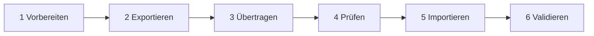

# Hyper-V – VM Export & Import

> [!info] Lernziel
> VM zwischen Hyper-V-Hosts **umziehen** oder **klonen**: exportieren → übertragen → prüfen → importieren → validieren.

**Inhalt:** [[#1 Schnellreferenz]] · [[#2 Ablauf]] · [[#3 Import-Modi]] · [[#4 Stolperfallen]] · [[#5 Häufige Fehler]] · [[#6 Validierung]] · [[#7 Aufgaben]] · [[#8 Klausur]] · [[#9 Glossar]]

---

## 1 Schnellreferenz

| Ziel | Befehl | Maschine |
|---|---|---|
| Exportieren | `Export-VM -Name EXA-SRV02 -Path 'C:\export1'` | Quellhost |
| `.vmcx` finden | `Get-ChildItem 'C:\export1\EXA-SRV02\Virtual Machines\*.vmcx'` | Zielhost |
| Prüfen | `Compare-VM -Path $vmcx -Copy …` | Zielhost |
| Umzug | `Import-VM -Path $vmcx -Copy` | Zielhost |
| Klon | `Import-VM -Path $vmcx -Copy -GenerateNewId` | Zielhost |

> [!important] Merksatz
> `-Path` zeigt **immer auf die `.vmcx`-Datei**, nie auf den Ordner. `-Copy` ist ein **Schalter** und bekommt keinen Wert.

---

## 2 Ablauf



### 2.1 Vorbereiten – Zielhost
```powershell
# Maschine: Ziel-Hyper-V-Host
Get-VMHostSupportedVersion | Select Version, IsDefault
Get-VMSwitch | Select Name, SwitchType
```

### 2.2 Exportieren – Quellhost
```powershell
# Maschine: Quell-Hyper-V-Host
Stop-VM -Name EXA-SRV02
Export-VM -Name EXA-SRV02 -Path 'C:\export1'
```
Ergebnis:
```text
C:\export1\EXA-SRV02\
├── Virtual Machines\   → .vmcx  .vmrs  .vmgs
├── Virtual Hard Disks\ → .vhdx
└── Snapshots\          → .avhdx
```
Dateien: [[VMCX]] · [[VMRS]] · [[VMGS]] · [[VHDX]] · [[AVHDX]]

### 2.3 Übertragen – Quellhost
```powershell
# Maschine: Quell-Hyper-V-Host
robocopy 'C:\export1\EXA-SRV02' '\\ZIELHOST\Import\EXA-SRV02' /E /J /MT:8 /R:2 /W:5
```
Entfällt bei Import auf demselben Host.

### 2.4 Prüfen – Zielhost
```powershell
# Maschine: Ziel-Hyper-V-Host
$vmcx   = (Get-ChildItem 'C:\export1\EXA-SRV02\Virtual Machines\*.vmcx').FullName
$ziel   = 'C:\VM2\EXA-SRV02b'
$report = Compare-VM -Path $vmcx -Copy -GenerateNewId `
          -VirtualMachinePath $ziel `
          -VhdDestinationPath "$ziel\Virtual Hard Disks" `
          -SnapshotFilePath   "$ziel\Snapshots"
$report.Incompatibilities | Format-Table MessageId, Message -AutoSize
```
Bei `33012` (Switch fehlt):
```powershell
$report.Incompatibilities | Where-Object MessageId -eq 33012 |
  ForEach-Object { $_.Source | Connect-VMNetworkAdapter -SwitchName 'LabSwitch' }
```

### 2.5 Importieren – Zielhost
```powershell
# Maschine: Ziel-Hyper-V-Host
$vm = Import-VM -CompatibilityReport $report
$vm | Rename-VM -NewName 'EXA-SRV02b'     # nur bei Klon
```

### 2.6 Validieren → [[#6 Validierung]]

---

## 3 Import-Modi

| Modus (GUI, engl.) | PowerShell | VM-ID | Dateien | Zweck |
|---|---|---|---|---|
| Register in-place | `-Path` | gleich | bleiben | liegen schon am Zielort |
| Restore | `-Path -Copy` | gleich | kopiert | **Umzug** |
| Copy | `-Path -Copy -GenerateNewId` | **neu** | kopiert | **Klon** |

> [!warning] Klon = gleiche Identität im Gast
> `-GenerateNewId` ändert nur die Hyper-V-ID. Computername, [[SID]], IP und Domänenkonto bleiben gleich.
> Vor parallelem Betrieb: [[Sysprep]] **oder** umbenennen + IP ändern + neu joinen.

---

## 4 Stolperfallen

| Prüfpunkt | Risiko | Gegenmaßnahme |
|---|---|---|
| [[Konfigurationsversion]] | VM neuer als Zielhost | `Get-VMHostSupportedVersion` |
| [[vSwitch]] | Name fehlt → 33012 | gleichen Namen anlegen / [[Compare-VM]] |
| Saved State ([[VMRS]]) | andere CPU → Startfehler | VM vorher herunterfahren |
| [[vTPM]] | Guardian-Zertifikate fehlen | Zertifikate mitnehmen |
| [[DC]] | Klon/alte Kopie → [[USN-Rollback]] | nur umziehen, nie parallel; [[VM-GenerationID]] |
| Speicher | Export = belegte VHDX-Größe | `Get-VHD` → `FileSize` |

---

## 5 Häufige Fehler

| Eingabe | Fehler | Ursache | Richtig |
|---|---|---|---|
| `Import-VM -Path .\EXA-SRV02\` | Abfrage `Copy:` | Parametersatz unklar | `-Copy` oder `-Register` angeben |
| `Import-VM -Path .\EXA-SRV02\ -Copy` | *ungültiger Parameter* | Ordner statt `.vmcx` | `-Path $vmcx` |
| `-Copy 'C:\VM2\…'` | *ungültiger Parameter* | Schalter mit Wert → Pfad landet in `-VhdDestinationPath` | Ziel über `-VirtualMachinePath` |
| `Rename-VM -Name EXA-SRV02` nach Klon | beide VMs betroffen | Name doppelt | über Objekt/Pfad filtern |

---

## 6 Validierung

```powershell
# Maschine: Ziel-Hyper-V-Host
$n  = 'EXA-SRV02b'
$vm = Get-VM -Name $n
$checks = [ordered]@{
  'VM vorhanden'     = [bool]$vm
  'VHDX vorhanden'   = (Get-VMHardDiskDrive -VMName $n | ForEach-Object { Test-Path $_.Path }) -notcontains $false
  'Switch verbunden' = [bool](Get-VMNetworkAdapter -VMName $n).SwitchName
  'Neue VMId'        = (Get-VM EXA-SRV02* | Select-Object -Unique VMId).Count -gt 1
}
$checks.GetEnumerator() | ForEach-Object { '{0,-17} {1}' -f $_.Key, $(if ($_.Value) {'OK'} else {'FEHLER'}) }
```
```powershell
# Maschine: EXA-SRV02b (Gast, nach Umbenennen/IP-Änderung)
Test-ComputerSecureChannel -Verbose
Test-Connection EXA-DC01 -Count 2
```

---

## 7 Aufgaben

### A1 – Modus wählen
Test-VM duplizieren, Original läuft weiter. Welcher Modus? Was reicht dabei nicht?
> [!hint]- Hinweis
> Was ändert `-GenerateNewId`, was nicht?

> [!success]- Lösung
> Copy (`-Copy -GenerateNewId`). Nur die Hyper-V-ID ist neu → zusätzlich [[Sysprep]] oder umbenennen/IP/neu joinen. → [[#3 Import-Modi]]

### A2 – Fehler analysieren
`Import-VM -Path .\EXA-SRV02\ -Copy` → *ungültiger Parameter*. Warum?
> [!success]- Lösung
> `-Path` braucht die `.vmcx`-Datei. → [[#5 Häufige Fehler]]

### A3 – Inkompatibilität
`MessageId 33012` – Ursache und Behebung?
> [!success]- Lösung
> [[vSwitch]] fehlt. `Connect-VMNetworkAdapter -SwitchName …` im Bericht, dann `Import-VM -CompatibilityReport`. → [[#2 Ablauf]]

### A4 – Praxis Home-Lab
EXA-CL01 klonen (gleicher Host), zwei verschiedene `VMId` nachweisen.
> [!success]- Lösung
> ```powershell
> # Maschine: Hyper-V-Host (Desktop)
> Export-VM -Name EXA-CL01 -Path 'C:\export1'
> $vmcx = (Get-ChildItem 'C:\export1\EXA-CL01\Virtual Machines\*.vmcx').FullName
> Import-VM -Path $vmcx -Copy -GenerateNewId -VirtualMachinePath 'C:\VM2\EXA-CL01b' `
>   -VhdDestinationPath 'C:\VM2\EXA-CL01b\Virtual Hard Disks' |
>   Rename-VM -NewName 'EXA-CL01b'
> Get-VM EXA-CL01* | Select Name, VMId
> ```

### A5 – Denkfrage
Warum ist ein alter DC-Export als „Backup“ gefährlich?
> [!success]- Lösung
> Veraltete USNs → [[USN-Rollback]], AD inkonsistent. Richtig: System-State-Backup.

---

## 8 Klausur
**20 Min · 20 Punkte**

1. Drei Import-Modi + je ein Einsatzzweck. *(6 P)*
2. Dateien in `Virtual Machines` + Funktion. *(3 P)*
3. Befehl: `EXA-WEB01` nach `F:\Export` exportieren, Maschine angeben. *(2 P)*
4. Warum Saved State vor Export entfernen? *(2 P)*
5. Import mit Kompatibilitätsprüfung: Cmdlets in Reihenfolge. *(4 P)*
6. Export/Import vs. Live-Migration. *(3 P)*

> [!success]- Lösungen
> 1. Register in-place · Restore (Umzug) · Copy (Klon) → [[#3 Import-Modi]]
> 2. [[VMCX]] Konfiguration · [[VMRS]] Laufzeitstatus · [[VMGS]] Gastzustand/vTPM
> 3. Quellhost: `Export-VM -Name EXA-WEB01 -Path 'F:\Export'`
> 4. CPU-abhängig → Start auf anderem Host kann scheitern.
> 5. `Get-VMHostSupportedVersion` → `Compare-VM` → Inkompatibilitäten beheben → `Import-VM -CompatibilityReport`
> 6. Export/Import: offline, Downtime, kein Cluster nötig. Live-Migration: ohne Downtime, Hosts verbunden, Delegierung/Authentifizierung nötig.

---

## 9 Glossar
[[VM-Export]] · [[VM-Import]] · [[VMCX]] · [[VMRS]] · [[VMGS]] · [[VHDX]] · [[AVHDX]] · [[Checkpoint]] · [[Konfigurationsversion]] · [[vSwitch]] · [[Compare-VM]] · [[vTPM]] · [[VM-GenerationID]] · [[USN-Rollback]] · [[SID]] · [[Sysprep]] · [[DC]]

Übersicht: [[00_Glossar-Index]]
