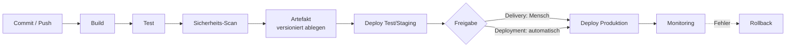

---
aliases:
  - CI-CD
  - CI/CD
  - Continuous Integration
  - Continuous Delivery
  - Continuous Deployment
  - Pipeline
tags:
  - glossar
  - glossar/web-daten-programmierung
en: Continuous Integration / Continuous Delivery (Deployment)
de: Kontinuierliche Integration / Auslieferung (Bereitstellung)
bereich: Web-Daten-Programmierung
---

**CI-CD** = *Continuous Integration / Continuous Delivery (bzw. Continuous Deployment)*
**Deutsch:** Kontinuierliche Integration / Auslieferung

## Kurz
CI/CD ist eine Arbeitsweise aus dem **DevOps**-Umfeld: Jede Änderung an Code oder Konfiguration durchläuft automatisch eine **Pipeline**, die baut, testet und ausliefert. Statt seltener großer Releases gibt es viele kleine, geprüfte Änderungen. Fehler fallen Minuten nach dem Commit auf, nicht Wochen später.

**Inhalt:** [[#Begriffe genau]] · [[#Pipeline Schritt für Schritt]] · [[#Umgebungen]] · [[#Teststufen]] · [[#Auslieferungsstrategien]] · [[#Branching]] · [[#Sicherheit (DevSecOps)]] · [[#Werkzeuge]] · [[#Beispiel GitHub Actions]] · [[#Kennzahlen]] · [[#Rolle des FiSi]] · [[#Prüfungsfragen]]

---

## Begriffe genau

| Stufe | Was automatisch passiert | Was manuell bleibt | Auslöser |
|---|---|---|---|
| **Continuous Integration** | Zusammenführen, Bauen, Testen bei jedem Push | Ausliefern | Commit / Pull Request |
| **Continuous Delivery** | + Ausliefern bis **Staging**, Paket jederzeit produktionsreif | **Freigabe** für Produktion | Freigabe-Klick (Approval) |
| **Continuous Deployment** | + Ausrollen in **Produktion** | nichts | erfolgreicher Testlauf |

> [!important] Merksatz
> **Integration** = Code wird ständig zusammengeführt und geprüft.
> **Delivery** = *könnte* jederzeit live gehen, ein Mensch gibt frei.
> **Deployment** = *geht* automatisch live.

Weitere Begriffe:

| Begriff | Bedeutung |
|---|---|
| Pipeline | Kette automatischer Schritte (Stages → Jobs → Steps) |
| Runner / Agent | Rechner, der die Pipeline ausführt |
| Artefakt | Ergebnis des Builds (Programm, ZIP, [[Image]]) |
| Quality Gate | Prüfpunkt: Pipeline stoppt, wenn Kriterium verfehlt (z. B. Tests < 80 % Abdeckung) |
| Trigger | Auslöser: Push, Pull Request, Zeitplan, manuell |
| Secret | geschützter Wert (Passwort, Token), nur zur Laufzeit verfügbar |
| Rollback | Rückkehr zur vorherigen funktionierenden Version |

---

## Pipeline Schritt für Schritt



| Nr. | Schritt | Inhalt | Beispiel |
|---|---|---|---|
| 1 | Trigger | Änderung im Repository | `git push`, Pull Request |
| 2 | Checkout | Code auf den Runner holen | `actions/checkout` |
| 3 | Build | kompilieren, Abhängigkeiten laden, Image bauen | `dotnet build`, `docker build` |
| 4 | Test | automatische Tests, Linter | `Invoke-Pester`, `Invoke-ScriptAnalyzer` |
| 5 | Scan | Sicherheitslücken, Geheimnisse im Code | Trivy, CodeQL |
| 6 | Artefakt | Ergebnis mit eindeutiger Version speichern | Image `meinweb:1.4.2` in [[Registry]] |
| 7 | Deploy | auf Zielumgebung ausrollen | `docker compose up -d`, Azure Web App |
| 8 | Prüfen | Smoke-Test / [[Healthcheck]] nach dem Ausrollen | HTTP 200 auf Startseite |
| 9 | Monitoring | Logs, Metriken, Alarme | Azure Monitor, Prometheus |

**Grundsatz „Build once, deploy many“:** Ein Artefakt wird **einmal** gebaut und unverändert durch alle Umgebungen geschoben. Nur Konfiguration (Variablen, Secrets) unterscheidet sich.

---

## Umgebungen

| Umgebung | Zweck | Wer nutzt sie |
|---|---|---|
| Dev | Entwicklung, darf kaputt sein | Entwickler |
| Test / QA | automatische und manuelle Tests | Tester |
| Staging | Kopie der Produktion, letzte Prüfung | Abnahme, Fachabteilung |
| Produktion | Echtbetrieb | Kunden, Mitarbeitende |

Im Lab entspricht das z. B. EXA-DOCKER01 (Test) und einem späteren EXA-WEB01 (Produktion).

---

## Teststufen
Testpyramide: unten viele schnelle, oben wenige langsame Tests.

| Stufe | Prüft | Anzahl | Dauer |
|---|---|---|---|
| Unit-Test | einzelne Funktion | sehr viele | Millisekunden |
| Integrationstest | Zusammenspiel (App + DB) | mittel | Sekunden |
| End-to-End-Test | kompletter Ablauf aus Nutzersicht | wenige | Minuten |
| Smoke-Test | „Läuft es überhaupt?“ nach Deploy | 1–3 | Sekunden |

---

## Auslieferungsstrategien

| Strategie | Ablauf | Vorteil | Nachteil |
|---|---|---|---|
| Recreate | alt stoppen, neu starten | einfach | kurze Ausfallzeit |
| Rolling | Server nacheinander aktualisieren | keine Ausfallzeit | kurz zwei Versionen gleichzeitig |
| Blue-Green | neue Umgebung (Green) parallel, dann umschalten | sofortiger Rollback | doppelte Ressourcen |
| Canary | erst z. B. 5 % der Nutzer auf neue Version | Risiko klein | aufwendiges Monitoring |
| Feature Flag | Code ausgeliefert, Funktion per Schalter aktiv | Freigabe unabhängig vom Deploy | Code wird komplexer |

---

## Branching

| Modell | Prinzip | Passt zu |
|---|---|---|
| Trunk-based | alle arbeiten auf `main`, kurze Feature-Branches (Stunden/Tage) | CI/CD, häufige Releases |
| GitFlow | `main`, `develop`, `feature/`, `release/`, `hotfix/` | geplante Versions-Releases |

Pull Request = Änderung wird **vor** dem Zusammenführen von der Pipeline geprüft und von Kollegen gesichtet (Review).

---

## Sicherheit (DevSecOps)
Sicherheit früh in die Pipeline verlagern („Shift Left“).

| Prüfung | Was | Beispiel |
|---|---|---|
| SAST | Quellcode auf Schwachstellen | CodeQL |
| SCA | verwendete Bibliotheken auf bekannte Lücken (CVE) | Dependabot |
| Container-Scan | Images auf Lücken | Trivy, Docker Scout |
| Secret-Scan | Passwörter/Token im Code | GitHub Secret Scanning |
| DAST | laufende Anwendung von außen testen | OWASP ZAP |

Regeln:
- Secrets nur im Secret-Speicher (GitHub Secrets, Azure Key Vault), **nie** im Repository
- Runner mit minimalen Rechten, Zugriff auf Produktion nur über geschützte Umgebungen mit Freigabe
- Pipeline-Dateien selbst per Review schützen – wer die Pipeline ändert, kann Code in Produktion bringen

---

## Werkzeuge

| Werkzeug | Konfiguration | Hosting | Hinweis |
|---|---|---|---|
| GitHub Actions | `.github/workflows/*.yml` | Cloud + selbst gehostete Runner | in GitHub integriert |
| GitLab CI/CD | `.gitlab-ci.yml` | Cloud oder eigener Server | komplett On-Premises möglich |
| Azure DevOps Pipelines | `azure-pipelines.yml` | Cloud + eigene Agents | Microsoft-Umfeld, Azure-Bezug |
| Jenkins | `Jenkinsfile` | selbst betrieben | Open Source, viele Plugins |

Verwandt: **Infrastruktur als Code** (Terraform, Bicep, Ansible, PowerShell DSC) – Server und Netze werden wie Software über Pipelines ausgerollt. **GitOps** – der Soll-Zustand liegt im Git, ein Werkzeug gleicht die Umgebung automatisch an.

---

## Beispiel GitHub Actions
Prüft PowerShell-Skripte, baut ein [[Docker]]-Image, legt es in der GitHub-Registry ab und rollt nach Freigabe aus.
Datei im Repository: `.github/workflows/ci-cd.yml`

```yaml
name: CI-CD
on:
  push:
    branches: [main]
  pull_request:

jobs:
  test:                                   # CI: bei jedem Push und Pull Request
    runs-on: windows-latest
    steps:
      - uses: actions/checkout@v4
      - name: PowerShell-Skripte prüfen
        shell: pwsh
        run: |
          Install-Module PSScriptAnalyzer -Force -Scope CurrentUser
          Invoke-ScriptAnalyzer -Path . -Recurse -Severity Error -EnableExit

  build:                                  # Artefakt erzeugen
    needs: test
    if: github.ref == 'refs/heads/main'
    runs-on: ubuntu-latest
    permissions:
      contents: read
      packages: write
    steps:
      - uses: actions/checkout@v4
      - name: Image bauen und hochladen
        run: |
          IMAGE="ghcr.io/${GITHUB_REPOSITORY,,}/meinweb:${{ github.sha }}"   # ,, = Kleinbuchstaben (Pflicht bei Images)
          echo "${{ secrets.GITHUB_TOKEN }}" | docker login ghcr.io -u ${{ github.actor }} --password-stdin
          docker build -t "$IMAGE" ./web
          docker push "$IMAGE"

  deploy:                                 # CD: nur nach Freigabe
    needs: build
    runs-on: ubuntu-latest
    environment: produktion               # Freigabe in GitHub unter Settings → Environments
    steps:
      - run: echo "Ausrollen von meinweb:${{ github.sha }}"
```

| Schlüssel | Bedeutung |
|---|---|
| `on` | Trigger |
| `jobs` / `steps` | Arbeitsschritte |
| `needs` | Reihenfolge und Abhängigkeit |
| `if` | Bedingung (nur `main` wird gebaut) |
| `secrets.*` | geschützte Werte |
| `environment` | Umgebung mit Freigaberegel → macht aus Deployment ein Delivery |
| `${{ github.sha }}` | Commit-ID als eindeutige Version |

---

## Kennzahlen
DORA-Metriken (DevOps Research and Assessment) messen, wie gut CI/CD funktioniert:

| Kennzahl | Frage |
|---|---|
| Deployment Frequency | Wie oft wird ausgeliefert? |
| Lead Time for Changes | Wie lange vom Commit bis Produktion? |
| Change Failure Rate | Wie viele Auslieferungen verursachen Störungen? |
| Time to Restore | Wie schnell ist eine Störung behoben? |

---

## Rolle des FiSi
- **Runner/Agents** betreiben und absichern (eigene Build-Server im Firmennetz)
- **Zielsysteme** bereitstellen: Server, Container-Hosts, Netzwerk, Firewall, DNS, Zertifikate
- **Secrets und Berechtigungen** verwalten (Dienstkonten, Key Vault, minimale Rechte)
- **Monitoring und Logs** einrichten, Rollback-Weg sicherstellen
- Eigene Admin-Skripte versionieren und per Pipeline testen (PSScriptAnalyzer, Pester)
- Abgrenzung: CI/CD automatisiert die **Auslieferung**, die [[CMDB]] dokumentiert den **Bestand**, Change-Management regelt die **Freigabe**

---

## Vorteile und Risiken

| Vorteile | Risiken |
|---|---|
| Fehler früh gefunden, Behebung billiger | schlechte Tests → Fehler gehen automatisch live |
| kleine Änderungen, leichter Rollback | Pipeline-Zugangsdaten sind lohnendes Angriffsziel |
| wiederholbar, nachvollziehbar (Audit) | Einrichtung und Pflege kosten Zeit |
| schnellere Lieferung an Kunden | Abhängigkeit von Cloud-Diensten (Ausfall Runner) |

---

## Prüfungsfragen
1. Unterschied zwischen Continuous Delivery und Continuous Deployment?
2. Nenne sechs typische Schritte einer Pipeline in richtiger Reihenfolge.
3. Was bedeutet „Build once, deploy many“ und warum ist es sinnvoll?
4. Warum gehören Passwörter nicht in die Pipeline-Datei? Wo gehören sie hin?
5. Vergleiche Blue-Green und Canary.
6. Welche Aufgaben übernimmt ein Fachinformatiker Systemintegration bei CI/CD?

> [!success]- Lösungen
> 1. Delivery: produktionsreif, Freigabe durch Menschen. Deployment: automatisch in Produktion.
> 2. Trigger → Build → Test → Scan → Artefakt ablegen → Deploy (→ Smoke-Test → Monitoring)
> 3. Ein Artefakt wird einmal gebaut und unverändert in alle Umgebungen gebracht; getestet wird genau das, was später live läuft.
> 4. Die Datei liegt im Repository und ist für alle mit Lesezugriff sichtbar. Secrets gehören in den Secret-Speicher (GitHub Secrets, Azure Key Vault).
> 5. Blue-Green: komplette zweite Umgebung, Umschalten für alle auf einmal, sofortiger Rollback. Canary: schrittweise für einen kleinen Teil der Nutzer, Risiko klein, Monitoring aufwendig.
> 6. Runner und Zielsysteme betreiben, Netzwerk/DNS/Zertifikate, Secrets und Berechtigungen, Monitoring, Rollback, eigene Skripte versionieren.

## Siehe auch
[[Docker]] · [[Docker-Compose]] · [[Image]] · [[Image-Tag]] · [[Registry]] · [[Healthcheck]] · [[Kubernetes]] · [[API]] · [[CLI]] · [[CMDB]] · [[00_Docker-Uebersicht]] · [[00_Glossar-Index]]
